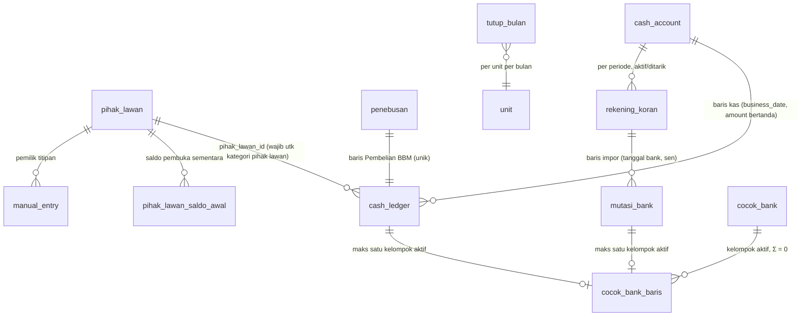
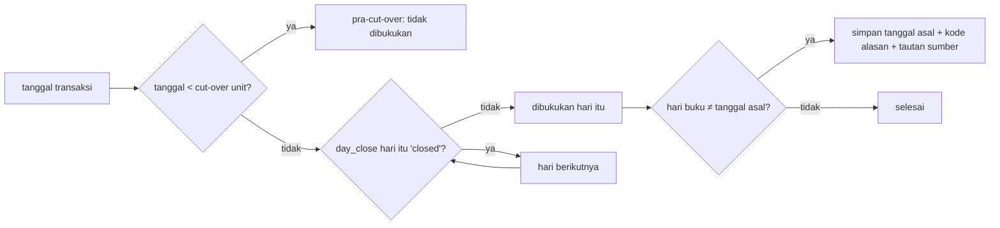
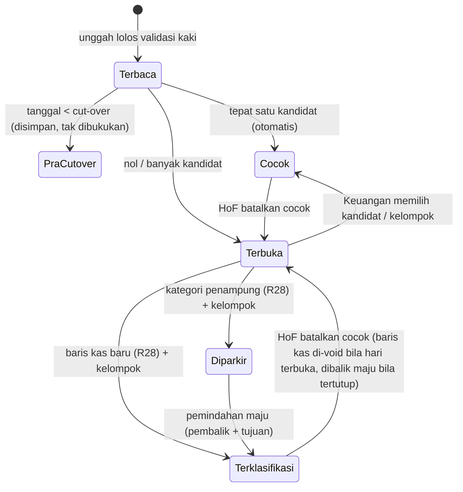

# Keuangan Terintegrasi — Pihak Lawan, Penebusan per SO, Impor Rekening Koran - Plan

## Goal Capsule

- **Objective:** Setiap mutasi rekening koran BCA unit SPBU punya tempat yang benar di Keuangan SolaMax, sehingga tim Finance bisa menjawab "berapa hutang/piutang kita ke pihak X per tanggal D" dari SolaMax, neraca harian tidak melompat karena mutasi yang tak tercatat, dan pajak dari setiap penebusan BBM terlihat terpisah.
- **Means:** Buku pembantu pihak lawan di atas buku kas yang sudah ada, penebusan per nomor SO, impor e-statement PDF BCA dengan pencocokan berbentuk tautan, dan koreksi yang selalu dibukukan maju (Key Decisions; KTD1, KTD3, KTD5).
- **Product authority:** Dion (Direktur / pemilik). Keputusan mengikat di `apps/dashboard/KEUANGAN-HARIAN.md` tetap berlaku dan dibaca sebelum menyentuh apa pun yang berbau keuangan; rencana ini menambah, tidak mencabutnya.
- **Execution profile:** Deep · empat fase (A pihak lawan, B penebusan, C impor, D tutup bulan & verifikasi) · uang, migrasi, lintas tenant.
- **Stop conditions:** Berhenti dan tanya Dion bila (a) bukti menunjukkan satu keputusan bertanda `session-settled` tidak bisa jalan, (b) sebuah perubahan akan menyunting migrasi yang sudah diterapkan, (c) sebuah jalur tulis baru akan menyentuh hari yang sudah ditutup selain lewat aturan R28, atau (d) promosi ke `main`/pilot diperlukan — itu instruksi Dion, bukan keputusan eksekutor.
- **Who finishes:** `ce-work` mengeksekusi di worktree `feat/keuangan-pihak-lawan` (dari `origin/staging`), membuka PR ke `staging`, dan memverifikasi di tier testing `-rlsstg`. Promosi ke pilot live hanya atas perintah Dion.
- **Open blockers:** Tidak ada untuk eksekusi. Uji penerimaan produksi butuh e-statement **Oktober 2026** Bakau (Dependencies).

---

## Product Contract

### Summary

Keuangan SolaMax mendapat buku pembantu per pihak lawan (unit lain, afiliasi, holding, pemilik titipan, kreditur, karyawan) dengan pinjaman antar unit yang dicatat sekali dan muncul di kedua buku. Penebusan BBM dicatat per nomor SO dengan empat komponen pajak terpisah dan langsung mengurangi saldo bank. E-statement PDF BCA bisa diunggah; mutasinya dicocokkan otomatis, sisanya diklasifikasi Finance atau diparkir di akun penampung yang wajib nol sebelum tutup bulan, dan semua koreksi dibukukan maju ke hari terbuka.

### Problem Frame

Pembukuan SolaMax dimulai 1 Oktober 2026. Tim Finance mengeluhkan tiga hal: pinjaman antar cabang (mis. Batu Layang ↔ Bakau) tidak bisa dicatat, hutang/piutang di luar pelanggan EasyMax (titipan Bright, antar cabang, holding) tidak punya buku, dan pajak dari bukti penebusan tidak terpisah.

Simulasi atas rekening koran Bakau (`6378301`, dua rekening BCA, Januari–September 2026, sekitar 1.500 mutasi; parser cocok dengan total & saldo akhir bank 18/18 sampai sen) terhadap fitur hari ini:

| Status di SolaMax hari ini | Porsi mutasi | Porsi nilai |
|---|---:|---:|
| Sudah ada tempatnya (setoran jemputan, transfer pelanggan, EDC, gaji, biaya bank, penyerahan titipan Bright) | ±63% | ±45% |
| Bisa dicatat tapi informasinya hilang (penebusan tanpa SO & pajak; pindah buku tanpa pasangan) | ±21% | ±47% |
| Tidak punya tempat yang benar (pinjaman antar unit/antar-PT, titipan selain Bright, angsuran, koreksi setoran, pajak jasa giro) | ±9% | ±5% |
| Tak bisa dikenali dari rekening koran saja | ±7% | ±3% |

Akar strukturalnya: modul Keuangan adalah buku kas/bank bertanda satu-sisi; kategori "Hutang Piutang" adalah satu ember tanpa pihak lawan; titipan hanya dikenal untuk Bright (§10.27), sehingga setoran Kebab dan titipan lain tidak punya tempat; satu transaksi tidak bisa menyentuh dua unit; penebusan hanya punya volume dari EasyMax dan baris kas manual bernilai gross; tidak ada impor rekening koran. Biayanya sudah terlihat: tutup hari Bakau 2 Okt melompat hampir −Rp 1 M karena pembayaran SO dan transfer pelanggan tak tercatat, dan empat unit lain menunjukkan pola serupa.

Tiga hal yang membuat ini bisa diotomasi, terbukti di data:

- Setiap debit B2B Pertamina membawa nomor SO di keterangan rekening koran; semua bukti penebusan berteks cocok persis ke debitnya lewat nomor SO.
- Pada semua bukti berteks, Net + PPN + PPh + PBBKB = Gross tepat.
- Lebih dari separuh bukti di arsip berupa gambar, jadi komponen pajak harus diketik, bukan dibaca dari berkas.

Kendala waktu yang membentuk rencana: hari ditutup setiap hari, sedangkan rekening koran tiba sebulan sekali sesudah bulan berakhir — saat impor, semua hari bulan itu sudah tertutup.

### Actors

- A1. Pengawas — mencatat setoran outlet titipan lewat Rincian Penjualan; tidak menulis buku pihak lawan, penebusan, atau impor.
- A2. Keuangan (tim Finance) — mengunggah e-statement, mengklasifikasi mutasi, mencatat pinjaman antar unit, mengetik penebusan.
- A3. Head of Finance (HoF) — mengisi saldo pembuka per pihak lawan, menutup bulan, dan memegang tindakan pembatalan (R31).
- A4. Direksi — membaca laporan dan saldo pihak lawan.
- A5. E-statement BCA — sumber luar; total & saldo akhir di kakinya adalah oracle impor.

### Key Decisions

- **Ketiga bagian dalam satu rencana bertahap.** Impor tanpa buku pihak lawan meninggalkan ±9% mutasi tanpa tujuan. (session-settled: user-directed — chosen over memegang satu bagian dulu (buku pihak lawan direkomendasikan): Dion ingin satu rencana yang langsung bisa dieksekusi dan diverifikasi.) Governs R1–R32.
- **Buku pembantu pihak lawan di atas buku kas yang ada, bukan jurnal berpasangan penuh.** Mesin CF/IS/BS dan gerbang tutup hari yang sudah teruji tidak dibongkar di tengah cut-over. (session-settled: user-approved — chosen over jurnal GL penuh dan "bank hanya lewat impor": tambahan paling kecil yang memenuhi tiga keluhan.) Governs R1–R9, R22.
- **Pinjaman antar unit dicatat sekali, dua sisi terbentuk otomatis.** Saldo per pasangan unit tidak bisa berbeda antar-buku. (session-settled: user-approved — chosen over tiap unit mencatat sendiri, dan lewat holding: selisih antar-buku tidak menjadi pekerjaan rutin.) Governs R3, R4.
- **Pencatat pinjaman lintas PT wajib berperan Keuangan di kedua unit.** Isolasi tenant tetap: staf yang hanya memegang satu PT tidak melihat buku PT lain. (session-settled: user-approved — chosen over "Keuangan satu sisi + konfirmasi sisi lain" dan "hanya super admin/HoF": tanpa langkah konfirmasi dan tanpa memusatkan pencatatan.) Governs R30.
- **Koreksi dibukukan maju ke hari terbuka; hari yang sudah ditutup tidak pernah disunting.** Mengikuti aturan "koreksi MAJU, bukan sunting MUNDUR" yang sudah berlaku. (session-settled: user-approved — chosen over "mundur ke tanggal bank lewat override per hari" dan "mundur tanpa gerbang": arsip tutup tetap beku tanpa ±30 override/unit/bulan.) Governs R3, R28, Success Criteria.
- **Mengetik penebusan dari bukti langsung membukukan pembayaran bank-nya.** Neraca harian berhenti melompat hari itu juga, bukan sebulan kemudian. (session-settled: user-approved — chosen over "tunggu impor": lompatan hampir −Rp 1 M tidak berulang tiap hari penebusan.) Governs R29.
- **Komponen pajak disimpan terpisah; HPP tetap Gross ÷ liter.** Laba tidak bergeser diam-diam sebelum konsultan pajak memutuskan perlakuan PPN masukan dan PPh 22. (session-settled: user-approved — chosen over PPN dikreditkan/PPh 22 final, keduanya dikreditkan, dan semua masuk HPP: perlakuan pajak milik konsultan pajak.) Governs R10, R14.
- **Komponen pajak diketik, tanpa unggah bukti ke SolaMax.** Bukti tetap diarsip di Drive. (session-settled: user-directed — chosen over unggah PDF + isi 4 angka (direkomendasikan) dan unggah + OCR: Dion memilih tanpa arsip di SolaMax.) Governs R11.
- **Impor tahap ini hanya e-statement PDF BCA.** Format yang sudah ada di Drive dan terbukti terbaca. (session-settled: user-approved — chosen over BCA + bank lain sekaligus, dan CSV KlikBCA: mulai dari format yang sudah dipegang.) Governs R17, R18.
- **Mutasi tak dikenal masuk akun penampung yang wajib nol sebelum tutup bulan.** Saldo bank tetap benar dan neraca tidak melompat, tanpa menahan tutup hari. (session-settled: user-approved — chosen over memblok tutup hari, dan penampung bebas: hari terbuka tidak menumpuk.) Governs R23–R25.
- **Mutasi BCA yang sudah diketik manual dicocokkan dengan impor, tidak dicatat dua kali.** Diambil dari pendekatan "bank hanya lewat impor" tanpa menutup ketik manual. Governs R19.
- **Titipan Bright yang sudah hidup diperluas, bukan dibangun ulang.** §10.27 (kategori "Titipan outlet Bright" + "Penyerahan titipan Bright", migrasi 0045) menjadi salah satu pihak lawan titipan; pemilik lain (Kebab) berperilaku sama. Governs R6.
- **Koreksi susulan dipisahkan dari selisih yang dinilai tutup hari.** Baris yang dibukukan maju tidak memaksa override Direksi setiap hari impor, dan selisih asli hari itu tidak tersembunyi di dalam angka susulan. (session-settled: user-approved — chosen over "tetap masuk selisih, ditutup lewat override Direksi": Direksi tidak menyetujui hampir setiap hari impor.) Governs R32.
- **Tindakan pembatalan hanya milik HoF.** Uang yang sudah direkonsiliasi tidak dibongkar oleh orang yang mencocokkannya; HoF dan Keuangan memang saling eksklusif (§10.12). Governs R31.

### Requirements

**Pihak lawan & buku pembantu**

- R1. Keuangan memelihara daftar pihak lawan per jenis: unit SolaMax (tersedia otomatis untuk ketujuh unit), afiliasi/holding non-SPBU (mis. PT Sola Petra Harmoni, SolaGroup), pemilik titipan (mis. outlet Bright, Kebab), kreditur (mis. BPR, UKBM), karyawan, dan lain-lain.
- R2. Setiap mutasi hutang/piutang di luar pelanggan EasyMax wajib menyebut satu pihak lawan, dan saldo per (unit, pihak lawan) bisa dibaca per tanggal mana pun beserta rincian mutasinya.
- R3. Pinjaman, pengembalian, atau titipan antar dua unit SolaMax dicatat sekali oleh Keuangan dan membentuk sisi lawannya di buku unit lain dalam tindakan yang sama, tiap sisi dibukukan menurut R28; tiap sisi berstatus "dalam perjalanan" sampai mutasi bank unit itu sendiri dicocokkan.
- R4. Untuk setiap pasangan unit, saldo piutang di satu buku sama dengan saldo hutang di buku lawannya pada setiap tanggal sesudah kedua sisinya dibukukan; ketidaksamaan di luar jendela itu ditampilkan sebagai cacat.
- R5. Pasangan unit milik PT yang sama (Imam Bonjol ↔ Bakau, PT Sola Petra Abadi) diperlakukan sama seperti pasangan lain dan diberi penanda "satu PT".
- R6. Setoran outlet titipan yang dicatat pengawas menambah saldo titipan ke pemiliknya dan penyerahan ke pemilik menguranginya, untuk Bright (perilaku §10.27 dipertahankan, termasuk baris lama yang sudah dikenali) maupun pemilik titipan lain seperti Kebab; titipan tidak pernah masuk laba.
- R7. HoF mengisi saldo pembuka per pihak lawan per tanggal cut-over unit, bertanda "sementara" seperti saldo pembuka akun kas; untuk pasangan unit, satu pengisian berlaku untuk kedua sisi.
- R8. Neraca harian dan pemeriksa neraca memakai saldo pihak lawan menggantikan agregat hutang-piutang non-EasyMax hari ini, sehingga mutasi yang tercatat dengan benar tidak mengubah langkah harian neraca.
- R9. Satu mutasi bank bisa dipecah menjadi beberapa baris klasifikasi yang jumlahnya tepat sama dengan nominal mutasi (mis. angsuran BPR = pokok ke pihak lawan kreditur + bunga ke beban).

**Penebusan per SO**

- R10. Setiap pembayaran penebusan tercatat per nomor SO dengan Harga Net, PPN, PPh, PBBKB, Nilai Nota Debet/Kredit, dan Harga Gross, dan sistem menolak simpan bila Net + PPN + PPh + PBBKB + Nota Debet/Kredit ≠ Gross (toleransi Rp 0).
- R11. Bila debit bank B2B Pertamina sudah diimpor, nomor SO, tanggal bayar, rekening, dan Gross terisi darinya dan Keuangan hanya mengetik komponen pajaknya.
- R12. Penebusan tertaut ke SO EasyMax yang sama (produk & volume) bila ada, dan yang belum tertaut terlihat sebagai daftar terbuka.
- R13. Rekap pajak penebusan per bulan per unit dan per PT menampilkan total PPN, PPh, PBBKB beserta daftar SO-nya, dan bisa diekspor.
- R14. Pencatatan penebusan tidak mengubah HPP, harga beli, maupun laba hari ini; perlakuan pajak per jenis pajak tetap di luar rencana ini.
- R15. Debit Pertamina non-SO (mis. "KURANG BAYAR", biaya audit) dicatat sebagai penyesuaian penebusan atau beban dengan referensi dari keterangan bank, tanpa wajib tertaut ke SO.
- R16. Baris arus kas "Penebusan SO" di laporan harian bersumber dari pembayaran penebusan yang tercatat, bukan lagi kosong.
- R29. Penebusan yang diketik dari bukti sebelum rekening koran diimpor langsung membukukan kredit bank kategori Pembelian BBM sebesar Gross; impor kemudian mencocokkannya lewat nomor SO dan tidak membuat baris kedua.

**Impor rekening koran**

- R17. Keuangan mengunggah e-statement PDF BCA per rekening per bulan; sistem menolak berkas bila total mutasi CR/DB, jumlah mutasi, atau saldo akhir hasil baca tidak sama persis dengan kaki rekening koran.
- R18. Rekening koran hanya diterima untuk rekening yang terdaftar di unit itu (nomor rekening cocok), dan saldo awalnya dibandingkan dengan saldo buku hari sebelumnya; perbedaan ditampilkan.
- R19. Mengunggah ulang periode yang sama tidak menggandakan mutasi, dan mutasi yang sudah diketik manual di rekening itu dicocokkan dengan baris impor, bukan dicatat dua kali.
- R20. Sistem mencocokkan otomatis: setoran jemputan ↔ setoran pengawas yang disetujui, kredit EDC ↔ pencairan EDC, debit B2B Pertamina ↔ penebusan per SO (R29), dan pindah buku antar rekening sendiri ↔ kaki pasangannya.
- R21. Mutasi yang tidak tercocokkan diklasifikasi Keuangan ke kategori, pihak lawan (R2), pasangan antar unit (R3), penebusan (R10), atau pecahan (R9); yang belum bisa dikenali diparkir di "Mutasi Belum Teridentifikasi" (R23).
- R22. Tanggal sebelum cut-over unit tidak dibukukan dari impor, sesuai aturan cut-over yang berlaku.

**Penampung & tutup bulan**

- R23. Tiap unit punya akun penampung "Mutasi Belum Teridentifikasi"; mutasi yang diparkir menjaga saldo bank tetap benar dan bisa dipindahkan ke klasifikasi yang benar kapan pun sebelum bulan ditutup, dengan pemindahan dibukukan menurut R28.
- R24. Tutup hari tetap bisa dilakukan selama penampung bersaldo, dan layar tutup hari menampilkan daftar mutasi yang masih diparkir serta baris yang dibukukan maju ke hari itu.
- R25. HoF menutup bulan per unit; penutupan ditolak selama ada hari di bulan itu yang belum ditutup, ada mutasi bank bertanggal bank di bulan itu yang masih diparkir di penampung, ada rekening BCA aktif unit itu yang rekening korannya belum diimpor untuk bulan itu, atau ada baris buku di rekening itu yang tidak punya pasangan di rekening koran.

**Waktu pembukuan & wewenang**

- R28. Setiap baris yang lahir dari impor, klasifikasi, pemindahan penampung, pinjaman antar unit, penebusan, atau pembatalan dibukukan pada hari terbuka pertama unitnya pada atau sesudah tanggal transaksinya; tanggal asal disimpan sebagai keterangan, dan baris yang terdorong maju membawa kode alasan serta tautan ke sumbernya.
- R26. Hanya peran Keuangan yang menulis pihak lawan, pinjaman antar unit, penebusan, impor, dan klasifikasi mutasi; pengawas hanya mencatat setoran outlet titipan (R6); HoF memegang saldo pembuka pihak lawan (R7), tutup bulan (R25), dan pembatalan (R31).
- R27. Setiap klasifikasi, pemindahan dari penampung, dan pemecahan mutasi tercatat siapa dan kapan, mengikuti pola tindakan bernama di `KEUANGAN-HARIAN.md` (tanpa tombol Edit generik).
- R30. Pinjaman antar unit yang berbeda PT hanya bisa dicatat oleh pengguna yang berperan Keuangan di kedua unit (atau super admin); bila tidak, tindakan ditolak utuh tanpa satu sisi pun tertulis.
- R32. Pengaruh baris bertanggal asal sebelum hari bukunya terhadap langkah harian neraca ditampilkan terpisah sebagai "koreksi susulan" di layar tutup hari, tertaut ke baris dan kode alasannya, dan tidak ikut dalam selisih yang dinilai tangga toleransi tutup hari.
- R31. Membatalkan pencocokan, menarik rekening koran yang sudah diimpor, dan membalik pasangan antar unit adalah tindakan bernama milik HoF, masing-masing dengan kode alasan, jejak audit, dan sinyal di Pemantauan.

### Key Flows

- F1. Impor bulanan
  - **Trigger:** Keuangan mengunduh e-statement BCA bulan lalu.
  - **Actors:** A2, A5
  - **Steps:** Unggah PDF per rekening → sistem memvalidasi kaki rekening koran dan nomor rekening → mutasi dicocokkan otomatis → Keuangan mengklasifikasi sisanya atau memarkirnya → baris baru dibukukan maju (R28) → daftar "mutasi bank tanpa pasangan" dan "baris buku tanpa pasangan" untuk rekening itu kosong.
  - **Covered by:** R17–R23, R28
- F2. Pinjaman antar unit
  - **Trigger:** Bakau meminjamkan dana ke Batu Layang.
  - **Actors:** A2
  - **Steps:** Keuangan (berakses kedua unit) mencatat sekali → piutang Bakau dan hutang Batu Layang terbentuk "dalam perjalanan", masing-masing di hari terbuka unitnya → impor rekening Bakau mencocokkan debitnya → impor rekening Batu Layang mencocokkan kreditnya → kedua sisi "lunas di bank".
  - **Covered by:** R3, R4, R20, R28, R30
- F3. Penebusan
  - **Trigger:** Finance memegang bukti penebusan dari Drive, atau debit B2B Pertamina masuk dari impor.
  - **Actors:** A2
  - **Steps:** Keuangan mengetik SO + Gross + empat komponen → sistem memeriksa jumlah = Gross → kredit bank Pembelian BBM terbukukan → penebusan tertaut ke SO EasyMax → impor nanti mencocokkan debitnya lewat SO (bila impor lebih dulu, SO & Gross terisi dari debit).
  - **Covered by:** R10–R13, R16, R29
- F4. Titipan outlet
  - **Trigger:** Pengawas mencatat setoran outlet Bright atau Kebab di Rincian.
  - **Actors:** A1, A2
  - **Steps:** Setoran menambah titipan ke pemilik → setoran bank dicocokkan seperti setoran lain → transfer ke pemilik (dari impor) diklasifikasi sebagai penyerahan titipan ke pihak lawan itu → saldo titipan turun.
  - **Covered by:** R6, R20, R21
- F5. Tutup bulan
  - **Trigger:** Semua e-statement bulan itu sudah diimpor.
  - **Actors:** A2, A3
  - **Steps:** Keuangan mengosongkan penampung dan daftar tanpa pasangan → semua hari ditutup → HoF menutup bulan; koreksi sesudahnya dibukukan di bulan terbuka berikutnya.
  - **Covered by:** R23–R25, R28

### Acceptance Examples

- AE1. **Covers R3, R4, R28.** Given Keuangan mencatat pinjaman Bakau → Batu Layang Rp 500.000.000 tanggal 4 Okt dan kedua hari 4 Okt masih terbuka, when rekening Bakau sudah diimpor tetapi Batu Layang belum, then buku Bakau menunjukkan piutang ke Batu Layang Rp 500 jt "lunas di bank" dan buku Batu Layang menunjukkan hutang ke Bakau Rp 500 jt "dalam perjalanan", dan saldo pasangannya sama di kedua buku.
- AE2. **Covers R10.** Given penebusan Gross Rp 118.750.000, when Keuangan mengetik Net 100.000.000, PPN 11.000.000, PPh 250.000, PBBKB 7.500.000, then tersimpan; when PBBKB diketik 7.500.001, then ditolak dengan selisih Rp 1 ditampilkan.
- AE3. **Covers R17.** Given e-statement yang terbaca dengan total DB berbeda Rp 0,01 dari kaki rekening koran, when diunggah, then seluruh berkas ditolak dan tidak ada mutasi yang masuk.
- AE4. **Covers R19.** Given Keuangan sudah mengetik manual debit Rp 150.000.000 di BCA-5125036811 tanggal 1 Sep, when e-statement September diimpor, then baris itu tercocokkan dengan baris impor dan saldo bank tidak berkurang dua kali.
- AE5. **Covers R23–R25.** Given debit Rp 500.000.000 tanpa keterangan diparkir di penampung pada 15 Okt, when HoF menutup Oktober, then ditolak; tutup hari 15 Okt tetap boleh dan menampilkan baris yang diparkir.
- AE6. **Covers R9.** Given debit angsuran BPR Rp 6.500.000, when Keuangan memecahnya menjadi pokok Rp 6.000.000 ke pihak lawan BPR dan bunga Rp 500.000 ke beban, then tersimpan; pecahan yang jumlahnya tidak Rp 6.500.000 ditolak.
- AE7. **Covers R6.** Given pengawas mencatat setoran outlet Bright Rp 25.000.000, when transfer ke pemilik Bright Rp 25.000.000 diklasifikasi sebagai penyerahan titipan, then saldo titipan Bright kembali nol dan laba hari mana pun tidak berubah.
- AE8. **Covers R22.** Given cut-over Bakau 1 Okt 2026, when e-statement September diunggah di produksi, then mutasinya tidak dibukukan.
- AE9. **Covers R28.** Given hari 1–31 Okt Bakau sudah ditutup dan hari 3 Nov terbuka pertama, when transfer pelanggan Rp 160.000.000 bertanggal bank 2 Okt diklasifikasi pada 5 Nov, then barisnya dibukukan 3 Nov dengan tanggal asal 2 Okt dan kode alasan impor susulan, dan arsip tutup 2 Okt tidak berubah.
- AE10. **Covers R20, R29.** Given dua penebusan bernilai sama Rp 180.000.000 pada tanggal yang sama dengan SO berbeda, when rekening koran diimpor, then tiap debit tercocokkan ke penebusan dengan SO yang tertulis di keterangannya, bukan berdasarkan nominal.
- AE11. **Covers R20.** Given setoran pengawas Rp 250.000.000 disetujui bertanggal 2 Sep, when kredit "SETORAN JEMPUTAN" Rp 250.000.000 bertanggal bank 3 Sep diimpor dan hanya satu kandidat cocok, then keduanya tertaut otomatis tanpa baris baru dan tanggal baris setoran tidak berubah.
- AE12. **Covers R30.** Given pengguna berperan Keuangan hanya di tenant PT Sola Petra Abadi, when ia mencatat pinjaman Bakau → Batu Layang, then ditolak dan tidak ada baris tertulis di Bakau maupun Batu Layang.

- AE13. **Covers R28, R32.** Given transfer pelanggan Rp 160.000.000 bertanggal bank 2 Okt dibukukan maju ke 3 Nov dan tidak ada selisih lain pada 3 Nov, when tutup hari 3 Nov dibuka, then koreksi susulan +Rp 160.000.000 tampil terpisah dengan tautannya, selisih yang dinilai Rp 0, dan hari bisa ditutup tanpa override.

### Success Criteria

- Uji ulang rekening koran Bakau Januari–September 2026 di tier testing: 18/18 berkas diterima dengan kaki rekening koran cocok, semua debit B2B Pertamina menemukan nomor SO-nya, dan setiap mutasi berakhir tercocokkan, terklasifikasi, atau diparkir — tidak ada yang hilang diam-diam.
- Di produksi, sesudah e-statement Oktober Bakau diimpor dan diklasifikasi, lompatan hampir −Rp 1 M pada 2 Okt terjelaskan oleh baris impor yang tertaut dan dibukukan maju ke hari koreksi; arsip tutup 2 Okt tidak berubah, dan langkah harian hari-hari sesudah koreksi tidak lagi melompat karena penebusan yang tak tercatat.
- Tim Finance bisa menjawab "berapa saldo pinjaman Bakau ↔ Batu Layang per 31 Okt" dan "berapa PPN penebusan Bakau Oktober" langsung dari SolaMax.

### Scope Boundaries

- OCR atau unggah bukti penebusan ke SolaMax; bukti tetap di Drive.
- Bank selain BCA (BRI, Mandiri, BNI) dan format CSV; rekening itu tetap diketik manual sampai ada contoh berkasnya.
- Jurnal berpasangan penuh, buku besar per akun CoA, dan neraca saldo — kandidat langkah berikutnya sesudah buku berjalan stabil.
- Perlakuan pajak (PPN masukan dikreditkan, PPh 22 sebagai uang muka) dan perubahan HPP.
- Bunga, jadwal angsuran, dan jatuh tempo pinjaman.
- Laporan konsolidasi per PT dan eliminasi pasangan satu PT.
- Pembukuan riwayat sebelum cut-over.
- Penanganan otomatis transfer pelanggan yang masuk ke rekening unit lain (mis. "PELANGGAN-X BAYAR VIA IB"); diklasifikasi manual lewat R21 sebagai pasangan antar unit.
- Membuka kembali bulan atau hari yang sudah ditutup.
- **Dipertimbangkan, tidak dibangun — alur persetujuan dua langkah untuk pembatalan.** R31 menaruh pembatalan di tangan HoF saja, dan HoF tidak bisa menginput (§10.12), sehingga peminta ≠ pencocok sudah terjamin. Berubah bila HoF ternyata ikut mencocokkan.
- **Dipertimbangkan, tidak dibangun — menutup celah tulis ke hari tertutup pada ketik/batal mutasi manual yang sudah ada** (`simpanMutasiKas`, `voidMutasiKas`). Rencana ini hanya menjaga jalur baru; celah lama dicatat di Open Questions untuk Dion.
- **Dipertimbangkan, tidak dibangun — ekspor CSV buku pembantu pihak lawan.** R2 hanya meminta saldo & rincian terbaca; satu-satunya ekspor yang diminta adalah rekap pajak (R13). Murah ditambahkan bila Finance memintanya.
- **Dipertimbangkan, tidak dibangun — pencocokan otomatis berbasis kombinasi jumlah (subset-sum).** Pencocokan otomatis hanya bila tepat satu kandidat; kelompok banyak-ke-banyak dipilih manusia. Berubah bila volume pencocokan manual terbukti menghambat.

### Dependencies / Assumptions

- E-statement Oktober 2026 Bakau dan rekening BCA unit lain diunduh tim Finance; di Drive per 29 Okt baru ada Januari–September Bakau dan satu berkas Korek.
- HoF mengisi saldo pembuka pihak lawan per 1 Okt, termasuk pinjaman yang masih berjalan dari sebelum Oktober.
- Pembelian Dex oleh PT Sola Petra Harmoni di Bakau diasumsikan tercatat sebagai pelanggan EasyMax, sehingga transfernya adalah pembayaran piutang pelanggan; bila tidak, ia menjadi piutang pihak lawan SPH (R2).
- Format e-statement BCA stabil seperti 18 berkas yang diuji (giro, keterangan multi-baris, kaki MUTASI CR/DB/SALDO AKHIR).
- Tim Finance yang mencatat pinjaman lintas PT punya keanggotaan Keuangan di kedua tenant; bila belum, super admin menambahkannya lewat `/admin`.
- Aturan repo berlaku: deploy staging-first, migrasi lewat CD, data EasyMax read-only.

### Outstanding Questions

**Deferred to Planning** — dijawab di Planning Contract di bawah (KTD dan Implementation Units); tidak ada yang tersisa memblokir.

**Untuk Dion (tidak memblokir eksekusi)**

- Celah lama: ketik dan batal mutasi manual masih bisa menulis ke hari yang sudah ditutup tanpa jejak di gerbang mana pun. Rekomendasi: terapkan R28 ke jalur lama juga dalam PR terpisah sesudah fase A tayang.

### Sources / Research

- Basis kode = `origin/staging` (migrasi terbaru `0048_gl_content_revision`, "gl" = gain/loss).
- `apps/dashboard/KEUANGAN-HARIAN.md` — §1.2 (langkah harian), §2 (kepemilikan, tindakan bernama, §2.3b override), §3 (tangga toleransi Rp 0 GL), §4.1b (aturan RLS tabel baru), §10.12 (HoF ⟂ Keuangan), §10.15 (hari tertutup tidak dihitung ulang), §10.24–§10.29.
- `apps/backend/prisma/migrations/0029_cash_ledger/migration.sql` — `cash_account`, `cash_ledger` (bertanda, `business_date`, FK komposit `(account_id, unit_id)` :155), kategori :110–126, blok RLS :258–277.
- `apps/dashboard/src/lib/kas-actions.ts` (`simpanMutasiKas`, `setujuiSetoran`, `voidMutasiKas`, `tetapkanSaldoAwal`), `apps/dashboard/src/lib/edc-actions.ts` (`setujuiPencairan` — kaki berpasangan dalam satu transaksi).
- `apps/dashboard/src/lib/keuangan-laporan-queries.ts` (`penebusanSo: null` :332; agregat "Hutang Piutang" :208/:303), `keuangan-laporan-model.ts` (`panelCashFlow`, `panelBalance` :266–318), `titipan-bright.ts`, `keuangan-wewenang.ts`, `tutup-hari-actions.ts`, `keuangan-pantau-model.ts`.
- `apps/dashboard/src/lib/config.ts:41-46` dan `scope-rule.ts:54-64` — tiap unit selain IB+Bakau adalah tenant tersendiri.
- `docs/plans/2026-10-29-1719-feat-keuangan-pihak-lawan-penebusan-impor-bank-plan-assets/` — `parse_rk.py` (pembaca e-statement BCA dari `pdftotext -layout`). Skrip pemetaan mutasi (`classify.py`) memuat nama pihak lawan nyata sehingga disimpan di luar repo (`~/.solaq-scripts/keuangan-sim/` di mesin Dion). Data rekening koran tidak disalin ke repo.
- Rekening koran Bakau: Drive bersama `SPBU 63.783.01 BK/Finance SPBU 6378301 BK/Rekening Koran/`; bukti penebusan Bakau: `FILE PENGAWAS SPBU/Arsip Bukti Penebusan/` (NPSO Ship To 965000, PSO Ship To 859303).
- Wiki vault: `wikis/spbu-sola/wiki/concepts/model-keuangan-spbu.md`, `wikis/spbu-sola/wiki/sources/2026-10-26-selisih-neraca-bakau-penebusan-tak-tercatat.md`, `wikis/spbu-sola/wiki/reference/kode-pelanggan-pertamina-dan-harga-tebus.md`.

**Product Contract preservation:** changed: R3, R4, R11, R23, R24, R25 (termasuk klarifikasi review: penampung diukur per tanggal bank), Success Criteria butir 2, AE1 — keputusan susulan di dialog ce-plan (koreksi maju, penebusan langsung membukukan bank, wewenang lintas PT); ditambah R28–R32, AE9–AE13, tiga butir "dipertimbangkan, tidak dibangun". Makna R1–R2, R5–R10, R12–R22, R26–R27 tidak berubah.

---

## Planning Contract

### Key Technical Decisions

- KTD1. **Pihak lawan adalah master ber-unit, bukan global.** Tabel pihak lawan memakai `unit_id` dan RLS `unit_scope` biasa (§4.1b), sehingga nama afiliasi/kreditur satu tenant tidak bocor ke tenant lain. Pihak lawan berjenis "unit" menyimpan unit lawannya; tujuh unit di-seed sebelum blok RLS. Penanda "satu PT" (R5) diturunkan dari peta tenant saat baca, tidak disimpan. Governs R1, R5.
- KTD2. **Saldo pihak lawan = saldo pembuka + kebalikan arus kas bertautan pihak lawan.** Baris `cash_ledger` mendapat kolom pihak lawan; piutang bertambah saat kas keluar (kredit) dan berkurang saat kas masuk. Term neraca yang menggantikan agregat "Hutang Piutang" memakai **piutang = −Σ amount**, memperbaiki tanda yang terbalik hari ini (`keuangan-laporan-queries.ts:208`). Saldo pembuka per pihak lawan disimpan terpisah (bukan baris kas), bertanda "sementara", mengikuti pola `tetapkanSaldoAwal` (void + insert + `audit_log`). Governs R2, R7, R8.
- KTD3. **Pihak lawan wajib untuk baris baru lewat CHECK `NOT VALID`.** Constraint `void OR kategori bukan kategori pihak-lawan OR pihak lawan terisi` ditambahkan `NOT VALID`: ditegakkan untuk setiap insert/update sejak migrasi tanpa memaksa baris Oktober lama, dan baris lama tetap bisa di-void. Baris lama "Hutang Piutang" tanpa pihak lawan diselesaikan Finance lewat tindakan bernama "Tetapkan pihak lawan" yang mengisi kolom itu **sekali** (`WHERE pihak_lawan_id IS NULL`) dengan `audit_log`; nominal, tanggal, dan kategori tidak berubah. Governs R2, R27.
- KTD4. **Pasangan antar unit = dua baris kas dalam satu transaksi, terikat satu kunci pasangan.** Tidak ada tabel pasangan lintas unit: tiap kaki berada di unitnya sendiri dengan RLS & FK komposit apa adanya; transaksi menyetel `app.unit_ids` ke kedua unit setelah **kedua** `requireUnit` lolos dan peran Keuangan terbukti di kedua keanggotaan (R30). Kesamaan saldo (R4) diperiksa oleh pembaca dua unit (`qScoped([a,b])`) dan tampil di Pemantauan untuk pengguna yang melihat keduanya. Pola rujukan: `setujuiPencairan` (kaki berpasangan dalam satu transaksi). Governs R3, R4, R30. (session-settled: user-approved — lihat Key Decision "Pencatat pinjaman lintas PT…".)
- KTD5. **Satu aturan tanggal buku untuk semua jalur tulis baru.** Satu fungsi murni: tanggal transaksi < cut-over unit ⇒ "pra-cut-over, tidak dibukukan" (R22); selainnya hari buku = hari pertama ≥ tanggal transaksi yang `day_close`-nya tidak `closed`. Jalur tulis baru memanggilnya **di dalam transaksi yang sama**: baris `day_close` hari tujuan dipastikan ada (`INSERT … ON CONFLICT DO NOTHING` berstatus open) lalu dikunci `FOR SHARE`, dan `tutupHari` menghitung ulang `difference_rp` di bawah `FOR UPDATE`-nya sebelum menutup, sehingga baris yang masuk sesudah layar dibuka ikut terhitung. Baris yang terdorong maju menyimpan tanggal asal dan kode alasan dari master `reason_code` (`applies_to='adjustment'`, kode baru di-seed per sumber: impor susulan, antar unit, penebusan, pemindahan penampung, pembatalan). Governs R28. (session-settled: user-approved — lihat Key Decision "Koreksi dibukukan maju…".)
- KTD6. **Pencocokan adalah tautan, tidak pernah menyunting buku.** Mutasi bank disimpan sebagai baris impor; hasil penyelesaian setiap baris impor adalah satu **kelompok cocok** aktif yang mengikat N baris impor ↔ M baris kas dengan Σ keduanya sama tepat (Rp 0, dicek di aksi dan di pemeriksa integritas). Klasifikasi baris tak bertaut = membuat baris kas baru (R28) lalu kelompok cocok. Pencocokan ke baris yang sudah ada (setoran, EDC, ketikan manual, penebusan, kaki antar unit) tidak menulis baris kas apa pun. Partial unique index menjamin satu baris impor dan satu baris kas hanya di satu kelompok aktif. Governs R19–R21, R25.
- KTD7. **Kunci pencocokan otomatis per jenis; otomatis hanya bila tepat satu kandidat.** Debit B2B Pertamina hanya lewat nomor SO dari keterangan (pola `H0000<soldto><7 digit>` + 3 digit baris berikutnya), tidak pernah lewat nominal; "KURANG BAYAR" lewat nomor dokumen. Setoran jemputan: rekening sama, nominal sama, tanggal bank − tanggal buku ∈ [0, +3] hari. Kredit EDC: `edc_settlement.net_rp`, jendela [0, +3]. Pindah buku sendiri: nomor rekening terdaftar di unit yang sama (bukan nama pemegang), nominal & tanggal sama. Ketikan manual & kaki antar unit: rekening, tanda, nominal sama, tanggal asal sama. Selainnya kandidat ditampilkan untuk dipilih manusia, termasuk kelompok banyak-ke-banyak (KORCPU ikut kelompok setoran yang dikoreksinya). Governs R19, R20.
- KTD8. **Penampung = kategori, bukan akun kas.** Kategori "Mutasi Belum Teridentifikasi" (debet & kredit) duduk di rekening bank aslinya, sehingga saldo bank tetap benar; neraca mengimbanginya dengan term penampung `= −Σ amount` agar langkah harian tidak bergerak. Pemindahan = dua baris di rekening yang sama pada hari buku R28 (pembalik di penampung + baris tujuan), saling bertaut ke baris parkir; baris parkir tidak pernah disunting. Governs R23, R24.
- KTD9. **Penebusan adalah tabel `app` sendiri yang memiliki baris kasnya.** CHECK di DB: Net + PPN + PPh + PBBKB + Nota = Gross (numerik, tanpa toleransi). Menyimpan penebusan dalam satu transaksi membuat baris kredit "Pembelian BBM" sebesar Gross di rekening yang dipilih (R29), bertaut unik ke penebusan. SO disimpan ternormalisasi `lower(trim())`, sama dengan konvensi `cnoso` dan `so_macet`. SO dibayar dua debit = satu penebusan, satu baris kas Gross, kelompok cocok 2:1. Arus kas "Penebusan SO" = Σ baris kas kategori Pembelian BBM per hari, sehingga tidak ada hitung ganda dengan penebusan. Governs R10–R16, R29.
- KTD10. **Pembaca PDF = `pdftotext -layout` di image dashboard + parser TypeScript murni.** `poppler-utils` ditambahkan ke tahap runtime `apps/dashboard/Dockerfile`; parser yang terbukti 18/18 di simulasi diport ke TS dengan nominal sebagai **sen bulat** (bukan float), dan penolakan berkas utuh bila kaki tidak cocok. Unggah lewat server action FormData dengan `experimental.serverActions.bodySizeLimit` dinaikkan secukupnya (berkas nyata 30–75 KB). Ditolak: pustaka JS (pdfjs/unpdf) — geometri teks berbeda, bukti 18/18 tidak terbawa.
- KTD11. **Titipan digeneralisasi lewat pihak lawan berjenis titipan, Bright tetap jalan.** `manual_entry` mendapat pihak lawan pemilik titipan (kolom milik pengawas, §2.1); pemilik "Outlet Bright" di-seed per unit dan pengenal lama `titipan-bright.ts` memetakan baris lama ke pemilik itu. Kategori kredit baru "Penyerahan titipan" mewajibkan pihak lawan; baris lama "Penyerahan titipan Bright" tetap dihitung untuk Bright. Pemilik baru tidak punya pengenal berbasis kata — pengawas memilih pemilik secara eksplisit. Governs R6.
- KTD12. **Setiap kategori kas dipetakan ke tepat satu baris arus kas.** Karena R16 mengisi komponen terakhir yang kosong, cek arus kas akan menyala untuk pertama kalinya; tanpa pemetaan lengkap ia penuh alarm palsu. Guard test membandingkan daftar kategori yang di-seed migrasi dengan peta baris arus kas. Governs R16.
- KTD13. **Nomor rekening jadi kolom `cash_account`.** Diisi ulang dari pola `nama` yang sudah ditegakkan form (`^Bank\s+.+\s-\s*\d+$`), bisa disunting di Akun Kas; impor membandingkan angka ternormalisasi dari kepala rekening koran. Governs R18.
- KTD15. **Koreksi susulan = langkah penuh − langkah tanpa baris susulan.** Neraca hari D dihitung dua kali: dengan semua baris, dan tanpa baris kas yang tanggal asalnya < D. Selisihnya adalah koreksi susulan, disimpan di kolom baru `day_close` di samping `difference_rp`; `difference_rp` (yang menentukan tier) memakai langkah tanpa baris susulan. Baris susulan berpihak lawan menyumbang nol karena sudah seimbang di dalam SolaMax; yang menyumbang adalah baris yang lawannya sudah tercatat di EasyMax pada tanggal asal (mis. transfer pelanggan, penebusan). Tangga toleransi §3 sendiri tidak berubah. Governs R32.
- KTD14. **Tutup bulan = tabel baru + satu pembuat vonis murni.** Syarat R25 dihitung oleh satu fungsi murni (pola `periksaTutupHari`); aksi menulis hanya bila vonis lolos, oleh HoF atau super admin. Bulan tertutup tidak membuka jalan baru — hari-harinya sudah tertutup, sehingga R28 otomatis mendorong koreksi ke bulan berikutnya. Governs R25.

### High-Level Technical Design

**Bentuk data (ER).** Garis putus = tautan opsional.

`cash_ledger` mendapat: pihak lawan, kunci pasangan antar unit, tanggal asal, kode alasan maju, tautan ke baris parkir yang dipindahkan. Semua tabel baru ber-`unit_id` dengan RLS `unit_scope`.

**Aturan tanggal buku (KTD5).**

**Daur hidup baris impor (KTD6/KTD7/KTD8).**

**Alur impor (F1).** Unggah → `pdftotext -layout` → parser murni → validasi kaki & nomor rekening (tolak utuh) → simpan rekening koran + baris impor (idempoten via kunci alami) → mesin cocok murni mengusulkan → aksi menulis kelompok untuk kandidat tunggal → layar klasifikasi untuk sisanya.

### Assumptions

- Peran bersifat global per orang (`app.user_role` ber-PK `user_id`, diresolusi fail-closed oleh `resolveRole`); jangkauan tenant datang dari penugasan (`unitVisible`). R30 = `canInputKeuangan` atas `DataScope` **dan** `scope.requireUnit` lolos untuk kedua unit (super admin lolos). Jangan membaca peran dari baris keanggotaan secara langsung.
- `day_close` yang belum ada barisnya dianggap terbuka (sesuai `pastikanBarisDayClose` yang lahir saat halaman dibuka).
- Saldo awal rekening koran pertama sesudah cut-over ditampilkan sebagai pembanding saldo pembuka sementara (§10.26), tetapi impor tidak pernah menulis saldo pembuka; penggantinya tetap lewat `tetapkanSaldoAwal` oleh HoF.
- Rekening EDC (…8301) diperlakukan sebagai rekening BCA biasa; kreditnya dicocokkan ke pencairan EDC.

### Implementation Constraints

- Jangan sunting migrasi yang sudah diterapkan; koreksi lewat `CORRECTION.md` sedirektori.
- Nomor migrasi diklaim terlambat (sesudah rebase ke `staging` terbaru); `scripts/ci/check-migrations.sh` menolak tabrakan — sembilan worktree lain aktif.
- Setiap tabel baru: model Prisma (`@@schema("app")`), blok RLS sendiri dengan seed **sebelum** ENABLE/FORCE, `REVOKE DELETE`, dan entri di daftar `kasus` `keuangan-migrasi.test.ts`.
- Nominal ditulis sebagai teks/numeric ke DB; perbandingan Rp 0 dilakukan dalam sen bulat atau numeric SQL, tidak pernah float.
- Validasi aksi ditulis tangan dengan pesan yang menyebut perbaikannya (tidak ada zod di dashboard); nominal yang menentukan dibaca ulang di server.
- Rute halaman baru di `app/(app)/keuangan/**` memanggil `canViewLaporanKeuangan` (guard `gerbang-rute-keuangan`).
- Dashboard dan backend deploy bersamaan: kueri baru ke tabel baru di sqlcheck memakai penunggu skema (pola `wait-snapshot-schema.ts`).
- Rekening koran asli tidak pernah di-commit; fixture repo berupa teks tata-letak sintetis dengan nama & nominal karangan.
- **Gerbang dua unit untuk setiap tulis lintas unit.** Setiap aksi yang menulis `cash_ledger` atau saldo pembuka pihak lawan di lebih dari satu unit — pencatatan pasangan (U4), saldo pembuka pasangan (R7, U3), balik pasangan (R31, U4), dan batalkan cocok atas kelompok yang melahirkan kaki antar unit (U10) — wajib lolos `scope.requireUnit` untuk **kedua** unit dan pemeriksaan wewenang aksinya sendiri sebelum BEGIN, atau ditolak utuh. Batalkan cocok atas kaki pasangan selalu lewat jalur balik pasangan (kedua kaki), tidak pernah void sepihak.
- **FK komposit `(id, unit_id)` untuk setiap tautan antar tabel ber-unit** (idiom 0019/0029): `cash_ledger`→pihak lawan, `manual_entry`→pihak lawan, saldo pembuka→pihak lawan, penebusan→`cash_ledger`, baris impor→rekening koran, baris kelompok→kelompok/baris impor/`cash_ledger`. FK Postgres mengabaikan RLS, dan transaksi pasangan berjalan dengan dua unit di `app.unit_ids`.
- **Unggah berkas dikeraskan:** wewenang (`requireUnit` + `canInputKeuangan`) diperiksa sebelum berkas dibaca; tolak kepala bukan `%PDF`; `pdftotext` dipanggil lewat `execFile` dengan argv (tanpa shell), batas waktu tetap, dan batas halaman; `bodySizeLimit` dinaikkan ke nilai terkecil yang memuat berkas nyata (≤ 1 MB) karena berlaku untuk semua server action.

### Sequencing

Empat fase, masing-masing bisa menjadi satu PR ke `staging`:

- **Fase A — buku pihak lawan:** U1 → U2 → U3 → (U4, U5) → U6. Bisa tayang sendiri: Finance bisa mencatat pinjaman, titipan, angsuran secara manual.
- **Fase B — penebusan:** U7 (butuh U1, U2, U6).
- **Fase C — impor:** U8 → U9 → U10 → U11 (butuh A dan B).
- **Fase D — tutup bulan & verifikasi:** U12 → U13.

### System-Wide Impact

- **Batas tenant:** pertama kali ada tulis lintas unit (KTD4); keamanannya bergantung sepenuhnya pada dua `requireUnit` dan pemeriksaan wewenang aksi. RLS tidak melindungi dari scope yang salah (`0016/CORRECTION.md`).
- **Laporan harian semua unit:** term neraca hutang-piutang berubah tanda (perbaikan), cek arus kas menyala untuk pertama kalinya (KTD12), titipan diperluas. Angka acuan yang dikunci di §10.27 ("Riwayat angka acuan IB 24-09") harus tetap terbaca, atau perubahannya dicatat di §10.30+.
- **Tutup hari:** layar menampilkan baris parkir, baris maju, dan koreksi susulan; tangga toleransi tidak berubah, tetapi menilai selisih tanpa koreksi susulan (KTD15).
- **Pengawas:** formulir Rincian mendapat pilihan pemilik titipan; perilaku Bright tetap.
- **Image dashboard:** bertambah `poppler-utils`.

### Risks & Dependencies

| Risiko | Mitigasi |
|---|---|
| Tulis lintas tenant oleh pengguna tanpa akses kedua unit | R30 diuji integrasi dua-unit (pola `RLS_SURFACES_LIVE_DB` unit 8801/8802), termasuk kasus satu sisi ditolak ⇒ nol baris |
| Format e-statement BCA berubah dan gagal senyap | Tolak utuh bila kaki tidak cocok (R17); tidak ada jalur "terima sebagian" |
| Parser TS menyimpang dari simulasi Python | Uji lokal ber-gerbang env pada 18 berkas asli; hasil harus identik baris-per-baris dengan `parse_rk.py` |
| Cek arus kas menyala dan membanjiri alarm | KTD12 + guard test pemetaan kategori |
| Tabrakan nomor migrasi dengan worktree lain | Klaim nomor terakhir, rebase sebelum PR, CI check |
| Perubahan tanda term neraca menggeser langkah harian Oktober yang sudah ditutup | Hari tertutup tidak dihitung ulang (§10.15); catat di §10.30+ bahwa hari terbuka sesudah rilis memakai rumus baru |

### Alternative Approaches Considered

- **Tabel pasangan lintas unit dengan predikat RLS "salah satu unit".** Ditolak: memerlukan predikat RLS baru yang tidak sama dengan `PREDIKAT_0016` dan membuka baris yang terlihat lintas tenant; dua kaki ber-unit dengan kunci pasangan mencapai hal yang sama tanpa itu.
- **Mencocokkan dengan menyunting tanggal/nominal baris kas yang ada.** Ditolak: menyentuh hari tertutup dan menghapus jejak beda tanggal bank vs buku (KTD6).
- **Penampung sebagai jenis akun kas baru.** Ditolak: memindahkan uang dari rekening bank aslinya membuat saldo bank buku ≠ rekening koran (KTD8).

---

## Implementation Units

| U-ID | Judul | Berkas utama | Bergantung |
|---|---|---|---|
| U1 | Skema dasar pihak lawan, tanggal buku, penampung | `apps/backend/prisma/migrations/00NN_pihak_lawan/`, `schema.prisma` | — |
| U2 | Aturan tanggal buku & penjaga hari tertutup | `apps/dashboard/src/lib/hari-buku.ts` | U1 |
| U3 | Master pihak lawan, saldo pembuka, mutasi berpihak lawan, pecahan | `pihak-lawan-actions.ts`, `kas-actions.ts` | U1, U2 |
| U4 | Pasangan antar unit & pembaliknya | `antar-unit-actions.ts` | U3 |
| U5 | Titipan per pemilik | `titipan-bright.ts`, `manual-entry-actions.ts` | U3 |
| U6 | Laporan: neraca, arus kas, buku pembantu, Pemantauan | `keuangan-laporan-*.ts`, halaman pihak lawan | U3, U4, U5 |
| U7 | Penebusan per SO & rekap pajak | `penebusan-actions.ts`, migrasi penebusan | U1, U2, U6 |
| U8 | Pembaca e-statement BCA | `impor-bank-parser.ts`, `Dockerfile` | — |
| U9 | Unggah, simpan, tarik rekening koran | `impor-bank-actions.ts`, migrasi impor | U1, U8 |
| U10 | Mesin cocok & kelompok cocok | `cocok-bank-model.ts`, `cocok-bank-actions.ts` | U4, U7, U9 |
| U11 | Layar klasifikasi & pemindahan penampung | halaman impor, `klasifikasi-actions.ts` | U10 |
| U12 | Tutup bulan & tampilan tutup hari | `tutup-bulan-*.ts`, `tutup-hari/[date]` | U11 |
| U13 | Dokumentasi keputusan & uji ulang Bakau | `KEUANGAN-HARIAN.md`, skrip uji ulang | U12 |

### U1. Skema dasar pihak lawan, tanggal buku, penampung

**Goal:** Semua struktur data fase A ada di DB dengan RLS, tanpa mengubah perilaku layar.

**Requirements:** R1, R2, R5, R7, R23, R28; KTD1, KTD2, KTD3, KTD5, KTD8, KTD13.

**Dependencies:** —

**Files:**
- `apps/backend/prisma/migrations/00NN_pihak_lawan/migration.sql` (baru; nomor diklaim saat rebase)
- `apps/backend/prisma/schema.prisma`
- `apps/dashboard/src/lib/keuangan-migrasi.test.ts`
- `apps/dashboard/src/lib/nama-tabel.guard.test.ts` (bila perlu disesuaikan)

**Approach:**
1. Tabel pihak lawan ber-unit (jenis tertutup: unit, afiliasi, titipan, kreditur, karyawan, lain; unit lawan untuk jenis unit; aktif) dan tabel saldo pembuka pihak lawan (nominal bertanda, sementara, void + audit).
2. Seed per unit: enam pihak lawan berjenis unit untuk unit lain dan "Outlet Bright" berjenis titipan — **sebelum** blok ENABLE/FORCE.
3. `cash_ledger`: kolom pihak lawan (FK komposit ke pihak lawan unit yang sama), kunci pasangan, tanggal asal, kode alasan maju, tautan baris parkir; CHECK `NOT VALID` kategori pihak lawan ⇒ pihak lawan terisi (KTD3).
4. `cash_account`: kolom nomor rekening, diisi dari `nama`.
5. Kategori baru: "Mutasi Belum Teridentifikasi" (debet & kredit), "Penyerahan titipan" (kredit). Kode alasan `applies_to='adjustment'` untuk tiap sumber maju (KTD5).
6. `manual_entry`: kolom pemilik titipan (nullable).

**Patterns to follow:** `0029_cash_ledger` (RLS block, grants), `0045_titipan_bright` (seed kategori), `0036`/`0044` (kolom tambahan + partial unique), `0022_reason_code` (seed kode alasan).

**Test scenarios:**
- `keuangan-migrasi.test.ts` menerima migrasi baru: ENABLE+FORCE, predikat identik `PREDIKAT_0016`, jumlah tabel `unit_id SMALLINT NOT NULL` = jumlah tabel, DELETE di-revoke.
- Seed muncul sebelum blok RLS (guard kelas seed-before-RLS lulus; mutan yang memindahkan seed ke bawah gagal).
- `check-sql-syntax.mjs` mem-parse migrasi tanpa galat.
- Integrasi (DB tier testing): insert baris kas kategori pihak lawan tanpa pihak lawan ditolak; baris lama tanpa pihak lawan tetap terbaca **dan bisa di-void**.
- Integrasi: tautan FK komposit ke baris unit lain ditolak DB.
- Integrasi: baris pihak lawan unit A tidak terlihat dengan `app.unit_ids` = B.

**Verification:** Migrasi lolos `prisma migrate deploy` di DB tier testing; `pnpm check` hijau; tidak ada perubahan tampilan.

### U2. Aturan tanggal buku & penjaga hari tertutup

**Goal:** Satu fungsi yang semua jalur tulis baru pakai untuk menentukan hari buku dan menolak tulis ke hari tertutup.

**Requirements:** R22, R28; KTD5.

**Dependencies:** U1

**Files:**
- `apps/dashboard/src/lib/hari-buku.ts` (murni: tanggal transaksi + cut-over + daftar hari tertutup → hari buku, perlu-alasan)
- `apps/dashboard/src/lib/hari-buku-queries.ts` (membaca `day_close` di dalam transaksi dengan `FOR SHARE`)
- `apps/dashboard/src/lib/hari-buku.test.ts`
- `apps/dashboard/src/lib/tutup-hari-actions.ts` (hitung ulang `difference_rp` di bawah `FOR UPDATE` sebelum menutup)

**Approach:** Fungsi murni mengembalikan hari buku dan apakah terdorong maju; pembungkus kueri membaca cut-over (§10.24) dan hari tertutup dalam transaksi pemanggil. Tanggal sebelum cut-over → tidak dibukukan sama sekali (R22), dibedakan dari "maju".

**Execution note:** Implementasikan test-first; ini aturan yang dipakai lima jalur tulis.

**Patterns to follow:** pembacaan cut-over di dalam transaksi `simpanMutasiKas` (§10.24 butir 2); `periksaTutupHari` sebagai pembuat vonis murni.

**Test scenarios:**
- Covers AE9. Tanggal 2 Okt, hari 1–31 Okt tertutup, 1–2 Nov tertutup → hari buku 3 Nov, terdorong maju.
- Tanggal terbuka → hari buku = tanggal, tidak perlu alasan.
- Tanggal sebelum cut-over → "pra-cut-over, tidak dibukukan".
- Hari tanpa baris `day_close` → dianggap terbuka.
- Integrasi: dua transaksi bersamaan, satu menutup hari D sementara yang lain membukukan ke D → yang membukukan menunggu kunci dan berakhir di D+1 atau gagal bersih, tidak pernah menulis ke D tertutup.
- Integrasi: hari D belum punya baris `day_close` → jalur tulis membuatnya (status open) sebelum mengunci; penutupan bersamaan tetap tidak bisa menyelip.
- Baris dibukukan ke D sesudah layar tutup hari dibuka → `tutupHari` menghitung ulang dan memakai selisih terbaru.

**Verification:** Semua jalur tulis baru (U3, U4, U7, U10, U11) memanggil fungsi ini; guard test memeriksa pemanggilannya.

### U3. Master pihak lawan, saldo pembuka, mutasi berpihak lawan, pecahan

**Goal:** Finance bisa mengelola pihak lawan, mengisi saldo pembuka, mencatat mutasi bank/kas berpihak lawan, memecah satu mutasi, dan menyelesaikan baris "Hutang Piutang" lama.

**Requirements:** R1, R2, R7, R9, R26, R27; KTD1–KTD3.

**Dependencies:** U1, U2

**Files:**
- `apps/dashboard/src/lib/pihak-lawan-actions.ts`, `pihak-lawan-model.ts`, `pihak-lawan-queries.ts` (+ `.test.ts`, `.guard.test.ts`)
- `apps/dashboard/src/lib/kas-actions.ts` (mutasi berpihak lawan; pecahan sebagai satu aksi berbaris banyak)
- `apps/dashboard/src/lib/keuangan-wewenang.ts` (+ test: predikat per aksi)
- `apps/dashboard/src/app/(app)/keuangan/unit/[code]/pihak-lawan/page.tsx` dan komponen di `apps/dashboard/src/components/keuangan/`

**Approach:**
1. Aksi bernama: tambah/nonaktifkan pihak lawan (Keuangan); tetapkan/ganti saldo pembuka (HoF, pola `tetapkanSaldoAwal`, `audit_log` `pihak_lawan.saldo_awal.tetapkan|ganti`).
2. Formulir mutasi: kategori pihak lawan mewajibkan memilih pihak lawan; jenis titipan hanya untuk penyerahan.
3. Pecahan: satu aksi menulis N baris dengan Σ = nominal sumber (Rp 0), semuanya lewat U2.
4. "Tetapkan pihak lawan" untuk baris lama: mengisi kolom pihak lawan sekali dari NULL (KTD3), mencatat pelaku & waktu di `audit_log`, tidak mengubah nominal/tanggal/kategori.

**Patterns to follow:** `kas-actions.ts` kerangka `buka → requireUnit → alasanTakBolehInput → BEGIN → set_config → DML → COMMIT`; `reklas-actions.ts` untuk tindakan append-only.

**Test scenarios:**
- Covers AE6. Pecahan 6.500.000 = 6.000.000 (kreditur BPR) + 500.000 (beban) tersimpan; 6.000.000 + 499.999 ditolak dengan selisih Rp 1.
- Mutasi kategori pihak lawan tanpa pihak lawan ditolak di aksi (dan di DB, U1).
- Saldo pembuka oleh pengguna Keuangan non-HoF ditolak; oleh HoF tersimpan bertanda sementara; ganti = void + insert + audit.
- Pihak lawan unit lain tidak bisa dipilih bila nonaktif.
- Saldo per pihak lawan per tanggal = saldo pembuka − Σ amount sampai tanggal itu (model murni).
- Guard: aksi menolak pengawas dan HoF untuk input.

**Verification:** Finance di unit uji bisa mencatat pinjaman manual ke kreditur dan melihat saldonya per tanggal.

### U4. Pasangan antar unit & pembaliknya

**Goal:** Satu tindakan mencatat pinjaman/pengembalian/titipan antar dua unit sebagai dua kaki; HoF bisa membalik pasangan.

**Requirements:** R3, R4, R5, R28, R30, R31; KTD4, KTD5.

**Dependencies:** U3

**Files:**
- `apps/dashboard/src/lib/antar-unit-actions.ts`, `antar-unit-model.ts` (+ `.test.ts`, `.guard.test.ts`)
- `apps/dashboard/src/lib/antar-unit.integration.test.ts` (dua unit fiktif, gerbang env)
- `apps/dashboard/src/lib/keuangan-wewenang.ts`

**Approach:**
1. Masukan: unit pemberi & penerima, rekening di masing-masing, nominal, tanggal, jenis (pinjaman/pengembalian/titipan), catatan. Formulir hidup di halaman unit yang sedang dibuka (unit itu terisi), dengan tombol arah "Pinjamkan ke / Terima dari"; pilihan unit lawan hanya unit dalam jangkauan pengguna, unit lain tampil nonaktif dengan teks "Anda tidak berperan Keuangan di unit ini"; rekening unit lawan dimuat sesudah unit dipilih. Pemeriksaan R30 di server tetap penentunya.
2. `canInputKeuangan` (peran global) + `scope.requireUnit` untuk **kedua** unit; gagal salah satu ⇒ tolak sebelum BEGIN.
3. Satu transaksi, `app.unit_ids` = kedua unit, dua baris kas bertanda berlawanan, pihak lawan = unit lawan, kunci pasangan sama, hari buku per kaki lewat U2.
4. Balik pasangan (HoF): kedua kaki di-void bila harinya terbuka, dibalik maju bila tertutup; ditolak bila salah satu kaki ada di kelompok cocok aktif.
5. Model kesamaan saldo per pasangan untuk Pemantauan (U6).

**Execution note:** Mulai dari integration test dua-unit yang gagal untuk kasus penolakan satu sisi.

**Patterns to follow:** `setujuiPencairan` (kaki berpasangan dalam satu transaksi), `qScoped` untuk baca multi-unit, `scope.*.integration.test.ts` untuk uji isolasi.

**Test scenarios:**
- Covers AE1. Pinjaman Bakau → Batu Layang 500 jt: baris kredit di Bakau (pihak lawan BL), debet di BL (pihak lawan BK), kunci pasangan sama, saldo piutang BK = hutang BL.
- Covers AE12. Pengguna Keuangan hanya di tenant SPA mencatat BK → BL ⇒ ditolak, nol baris di kedua unit.
- Hari penerima tertutup ⇒ kaki penerima dibukukan di hari terbuka berikutnya dengan tanggal asal; status "dalam perjalanan" tidak dianggap cacat di jendela itu (R4).
- IB ↔ BK diberi penanda satu PT (R5).
- Balik pasangan oleh Keuangan ditolak; oleh HoF dengan kode alasan membuat dua pembalik bertaut, audit tercatat.
- Balik pasangan dengan kaki yang sudah tercocokkan ⇒ ditolak dengan pesan "batalkan cocok dulu".
- Mutan: menghapus salah satu `requireUnit` membuat uji isolasi merah.

**Verification:** Uji integrasi dua-unit hijau di DB tier testing; kesamaan saldo terlihat dari pembaca dua unit.

### U5. Titipan per pemilik

**Goal:** Pengawas memilih pemilik titipan (Bright, Kebab, …); saldo titipan per pemilik; perilaku Bright lama utuh.

**Requirements:** R6; KTD11.

**Dependencies:** U3

**Files:**
- `apps/dashboard/src/lib/titipan-bright.ts` (diperluas atau digantikan pengenal titipan per pemilik yang tetap mengekspor perilaku lama)
- `apps/dashboard/src/lib/manual-entry-actions.ts`, `apps/dashboard/src/components/rincian/ManualEntryForm.tsx`
- Konsumen pengenal: `keuangan-beban.ts`, `keuangan-pantau-queries.ts`, `keuangan-input-queries.ts`, `reklas-actions.ts`, `keuangan-laporan-queries.ts`
- Test: `titipan-bright.test.ts` (atau penggantinya), `manual-entry-actions` tests

**Approach:** Kolom pemilik di `manual_entry` diisi pengawas lewat pilihan wajib setiap kali titipan dicentang, berisi pemilik titipan aktif unit itu (Outlet Bright terpilih lebih dulu hanya untuk baris yang dikenali aturan §10.27; daftar kosong ⇒ teks "Pemilik tidak ada? Hubungi Keuangan"). Pemilik lain seperti Kebab ditambahkan Keuangan lewat master (U3) sebelum dipakai. Baris lama tanpa pilihan eksplisit yang dikenali sebagai Bright dipetakan ke pemilik "Outlet Bright". Penyerahan memakai kategori "Penyerahan titipan" + pihak lawan; baris lama "Penyerahan titipan Bright" terhitung untuk Bright.

**Patterns to follow:** satu pengenal tunggal TS + padanan SQL (`isTitipanBright` / `sqlTitipanBright`).

**Test scenarios:**
- Covers AE7. Setoran titipan Bright 25.000.000 + penyerahan 25.000.000 ⇒ saldo titipan Bright 0, laba tidak berubah.
- Setoran titipan Kebab dengan pemilik Kebab ⇒ saldo titipan Kebab naik, tidak masuk pendapatan lain.
- Baris lama berketerangan "SETORAN BRIGHT" tanpa pemilik ⇒ terhitung ke Outlet Bright (angka acuan §10.27 IB 24-09 tetap −119.737.483).
- Keterangan berbunyi "kebab" tanpa pemilik eksplisit ⇒ **tidak** dikenali otomatis.
- Penyerahan titipan tanpa pihak lawan ditolak.

**Verification:** Layar Rincian pengawas menampilkan pilihan pemilik; laporan unit uji menunjukkan liabilitas titipan per pemilik.

### U6. Laporan: neraca, arus kas, buku pembantu, Pemantauan

**Goal:** Laporan harian memakai saldo pihak lawan (tanda benar), penampung, titipan per pemilik, dan arus kas lengkap; ada halaman buku pembantu pihak lawan.

**Requirements:** R2, R4, R8, R16, R24 (bagian laporan), R32; KTD2, KTD8, KTD12, KTD15.

**Dependencies:** U3, U4, U5

**Files:**
- `apps/dashboard/src/lib/keuangan-laporan-queries.ts`, `keuangan-laporan-model.ts` (+ `.test.ts`)
- `apps/dashboard/src/lib/laporan-keuangan.guard.test.ts`
- `apps/dashboard/src/lib/keuangan-pantau-model.ts`, `keuangan-pantau-queries.ts`
- `apps/dashboard/src/app/(app)/keuangan/unit/[code]/pihak-lawan/page.tsx` (saldo per pihak per tanggal, rincian mutasi)
- `apps/dashboard/src/lib/queries.sqlcheck.integration.test.ts`

**Approach:**
1. Ganti term "Hutang Piutang" non-EasyMax dengan Σ saldo pihak lawan (piutang − hutang) memakai **−Σ amount** + saldo pembuka, **ditambah** −Σ amount baris kategori pihak lawan non-void yang pihak lawannya masih NULL, tampil sebagai "pihak lawan belum ditetapkan" sampai Finance menetapkannya.
2. Tambah term penampung (−Σ amount kategori penampung) dan titipan per pemilik.
3. `penebusanSo` = Σ baris kas Pembelian BBM hari itu; petakan setiap kategori kas ke satu baris arus kas.
4. Koreksi susulan (KTD15): model laporan menghitung langkah tanpa baris bertanggal asal < hari buku dan mengembalikan keduanya.
5. Pemantauan: sinyal baru — pasangan antar unit tidak seimbang di luar jendela, penampung bersaldo, baris lama "Hutang Piutang" tanpa pihak lawan, pembatalan oleh HoF.
6. Halaman buku pembantu: pemilih tanggal (bawaan hari ini) di atas tabel pihak lawan dikelompokkan per jenis — kolom Pihak lawan, Saldo (nilai mutlak + label eksplisit "Piutang"/"Hutang"), Status ("Dalam perjalanan"/"Lunas di bank", tanda "Satu PT", tanda merah "Tidak seimbang" bertaut ke Pemantauan); baris bersaldo nol diciutkan; baris dibuka menjadi rincian mutasi terurut tanggal dengan saldo berjalan.

**Execution note:** Tulis dulu tes mutan "debet Hutang Piutang 1 jt ⇒ langkah harian 0" yang merah di kode sekarang.

**Patterns to follow:** model murni + `SebabKosong` (null ≠ 0), `deltaKontribusi` (§10.29) sebagai preseden item non-laba yang wajib punya term neraca.

**Test scenarios:**
- Pinjaman diterima 1 jt (debet, pihak lawan kreditur) ⇒ kas +1 jt, hutang +1 jt, langkah harian 0.
- Baris lama "Hutang Piutang" 1 jt tanpa pihak lawan di hari terbuka ⇒ masuk "belum ditetapkan", langkah harian 0; sesudah "Tetapkan pihak lawan" ⇒ pindah ke saldo pihak itu, langkah tetap 0.
- Pinjaman diberikan ke unit lain 500 jt ⇒ kas −500 jt, piutang +500 jt, langkah 0.
- Parkir 500 jt di penampung ⇒ langkah 0; pemindahan ke beban ⇒ laba turun di hari pemindahan.
- Covers AE13. Transfer pelanggan 160 jt bertanggal asal 2 Okt dibukukan 3 Nov ⇒ langkah penuh +160 jt, koreksi susulan +160 jt, langkah dinilai 0.
- Pinjaman susulan berpihak lawan bertanggal asal lampau ⇒ koreksi susulan 0.
- `penebusanSo` terisi ⇒ cek arus kas terhitung; guard: setiap kategori yang di-seed migrasi punya baris arus kas (mutan: kategori baru tanpa pemetaan ⇒ merah).
- Saldo pembuka pihak lawan sementara ⇒ ditandai sementara di neraca seperti akun kas (§10.26).
- Halaman buku pembantu: saldo per pihak per tanggal sama dengan model; pengawas ditolak (`canViewLaporanKeuangan`).
- sqlcheck: kueri baru jalan di DB tier testing sesudah skema siap.

**Verification:** Laporan unit uji seimbang (langkah 0) untuk semua skenario di atas; angka acuan §10.27 tidak bergeser kecuali yang dicatat.

### U7. Penebusan per SO & rekap pajak

**Goal:** Finance mengetik penebusan per SO dengan empat pajak; kas berkurang hari itu; rekap pajak bulanan.

**Requirements:** R10–R16, R29; KTD9.

**Dependencies:** U1, U2, U6

**Files:**
- `apps/backend/prisma/migrations/00NN_penebusan/migration.sql`, `schema.prisma`
- `apps/dashboard/src/lib/penebusan-actions.ts`, `penebusan-model.ts`, `penebusan-queries.ts` (+ `.test.ts`, `.guard.test.ts`)
- `apps/dashboard/src/app/(app)/keuangan/unit/[code]/penebusan/page.tsx`, rekap pajak + ekspor di `app/api/keuangan/**`
- `apps/dashboard/src/lib/keuangan-migrasi.test.ts`

**Approach:**
1. Tabel penebusan ber-unit: SO ternormalisasi, tanggal bayar, rekening, Net, PPN, PPh, PBBKB, Nota, Gross, CHECK jumlah = Gross, tautan unik ke baris kas, void + audit; unik (unit, SO) di antara yang tidak void.
2. Simpan = satu transaksi. Bila sudah ada baris kas Pembelian BBM terbuka (rekening sama, nominal = Gross, tanggal asal sama, belum bertaut ke penebusan) — mis. yang diketik manual sejak 1 Okt — penebusan **mengikat baris itu** tanpa membuat baris baru; dua kandidat atau lebih ⇒ Keuangan memilih. Tanpa kandidat ⇒ penebusan + baris kas kredit Pembelian BBM sebesar Gross (hari buku U2).
3. Tautan ke `tebus_header.cnoso` (baca) untuk produk & volume; daftar SO belum tertaut.
4. Debit Pertamina non-SO (R15): baris kas Pembelian BBM atau beban dengan referensi; tidak wajib penebusan.
5. Rekap pajak per bulan per unit & per PT (gabungan unit satu tenant bagi pengguna yang melihatnya).
6. Void penebusan: hanya bila baris kasnya belum di kelompok cocok aktif dan harinya terbuka; selain itu lewat pembalikan maju.
7. Formulir: kaki "Σ komponen / Gross / Selisih" diperbarui saat mengetik dan Simpan nonaktif selama selisih ≠ 0; Nota Debet/Kredit satu isian bertanda (nota debet menambah, nota kredit mengurangi — tanda dicek ke satu bukti nyata sebelum dikunci); bila dibuka dari baris impor, SO, tanggal, rekening, dan Gross tampil terkunci berlabel "dari rekening koran". Daftar "SO belum tertaut" berupa tabel di halaman penebusan dengan keadaan kosong yang jelas.

**Patterns to follow:** CHECK numerik di DB (`day_close_tier_matches_difference`, `GENERATED` MDR 0030), normalisasi SO di `so_macet` (0028).

**Test scenarios:**
- Covers AE2. 100.000.000 + 11.000.000 + 250.000 + 7.500.000 + 0 = 118.750.000 tersimpan; PBBKB +1 ditolak (aksi dan CHECK DB).
- Simpan penebusan ⇒ satu baris kas −118.750.000 kategori Pembelian BBM bertaut; `penebusanSo` hari itu = 118.750.000.
- Baris Pembelian BBM −118.750.000 sudah diketik manual, lalu penebusan disimpan ⇒ tetap **satu** baris kas, kini bertaut ke penebusan.
- Dua baris manual bernominal sama di hari itu ⇒ tidak diikat otomatis; Keuangan memilih.
- SO duplikat di unit yang sama ditolak; SO dengan spasi/huruf besar dinormalisasi.
- SO ada di `tebus_header` ⇒ produk & volume tampil; tidak ada ⇒ masuk daftar belum tertaut.
- Rekap Oktober: total PPN/PPh/PBBKB = Σ penebusan Oktober; ekspor CSV memuat daftar SO.
- HPP/harga beli/laba tidak berubah oleh penebusan (R14).

**Verification:** Mengetik penebusan Bakau 2 Okt di unit uji menutup bagian penebusan dari selisih langkah harian hari itu.

### U8. Pembaca e-statement BCA

**Goal:** Teks `pdftotext -layout` diubah menjadi kepala, baris, dan kaki rekening koran dengan nominal sen bulat; berkas yang tidak cocok ditolak utuh.

**Requirements:** R17, R18 (nomor rekening dari kepala); KTD10.

**Dependencies:** —

**Files:**
- `apps/dashboard/src/lib/impor-bank-parser.ts` (murni) + `impor-bank-parser.test.ts`
- `apps/dashboard/src/lib/impor-bank-parser.real.test.ts` (gerbang env, membaca berkas asli dari direktori lokal di luar repo)
- `apps/dashboard/src/lib/__fixtures__/rekening-koran-sintetis-*.txt` (sintetis)
- `apps/dashboard/src/lib/pdf-teks.ts` (memanggil `pdftotext -layout` ke berkas sementara)
- `apps/dashboard/Dockerfile` (tahap runtime: `poppler-utils`)

**Approach:** Port logika `parse_rk.py`: baris awal bertanggal `DD/MM`, nominal + penanda `DB` + saldo opsional, keterangan lanjutan berindentasi, penghenti di kepala halaman & kaki; kepala memberi nomor rekening & periode; kaki memberi MUTASI CR/DB (nominal + jumlah) dan SALDO AKHIR. Ekstraksi SO dan nomor dokumen dari keterangan dilakukan di sini (dipakai U10). Validasi: Σ CR, Σ DB, jumlah, saldo awal + CR − DB = saldo akhir — semuanya sen bulat.

**Execution note:** Test-first dengan fixture sintetis; lalu jalankan uji ber-gerbang env pada 18 berkas asli dan bandingkan baris-per-baris dengan keluaran `parse_rk.py`.

**Patterns to follow:** model murni + test bersebelahan; berkas sementara di `/tmp` kontainer dihapus di `finally`.

**Test scenarios:**
- Fixture sintetis giro: 6 baris (setoran jemputan, B2B Pertamina dengan SO, biaya adm, BI-FAST tanpa nama, KORCPU, pajak bunga) ⇒ 6 baris, nominal sen tepat, SO terekstrak `7654321987`.
- Keterangan yang memuat "SALDO AWAL :" di ekor baris terakhir (pola rekening EDC) tidak merusak nominal baris itu.
- Kaki tidak cocok Rp 0,01 ⇒ galat "kaki tidak cocok", tidak ada baris dikembalikan (AE3).
- Kepala rekening "5 125 03 6811" ⇒ nomor ternormalisasi `5125036811`.
- Berkas bukan e-statement BCA ⇒ galat format yang jelas.
- Real (gerbang env): 18/18 berkas lolos validasi; jumlah baris & nominal identik dengan simulasi Python; semua debit Pertamina punya SO.

**Verification:** Uji sintetis hijau di CI; uji real hijau lokal; image dashboard memuat `pdftotext`.

### U9. Unggah, simpan, tarik rekening koran

**Goal:** Keuangan mengunggah PDF per rekening per bulan; baris tersimpan idempoten; HoF bisa menarik impor yang salah.

**Requirements:** R17–R19, R22, R31; KTD6, KTD13.

**Dependencies:** U1, U8

**Files:**
- `apps/backend/prisma/migrations/00NN_impor_bank/migration.sql`, `schema.prisma`
- `apps/dashboard/src/lib/impor-bank-actions.ts`, `impor-bank-queries.ts` (+ `.test.ts`, `.guard.test.ts`)
- `apps/dashboard/next.config.mjs` (batas ukuran server action)
- `apps/dashboard/src/app/(app)/keuangan/unit/[code]/impor-bank/page.tsx`
- `apps/dashboard/src/components/keuangan/` (komponen unggah & ringkasan)

**Approach:**
1. Tabel rekening koran (rekening, periode, saldo awal/akhir, total & jumlah CR/DB, sha256 berkas, pengunggah, status aktif/ditarik + alasan) unik (rekening, periode) di antara yang aktif; tabel baris impor (tanggal bank, urutan dalam hari, keterangan, nominal bertanda, saldo sesudah, SO, nomor dokumen) dengan kunci alami unik.
2. Unggah: parse (U8) → nomor rekening harus cocok dengan rekening unit (R18) → berkas identik (sha256) = no-op → berkas berbeda untuk periode aktif ditolak sampai ditarik.
3. Baris sebelum cut-over disimpan bertanda pra-cut-over, tidak pernah dicocokkan/dibukukan (R22).
4. Bandingkan saldo awal rekening koran dengan saldo buku rekening itu per hari sebelum periode **menurut tanggal asal** (baris bulan lalu yang dibukukan maju dihitung pada tanggal asalnya), sehingga baris susulan tidak menimbulkan selisih rutin; tampilkan selisih (kuning bila saldo pembuka masih sementara).
5. Tarik impor (HoF): hanya bila tidak ada baris yang ada di kelompok cocok aktif dan bulan rekening koran itu belum ditutup; status ditarik + alasan + audit.
6. Halaman impor: matriks rekening BCA (baris) × bulan sejak cut-over (kolom), tiap sel "belum diunggah" / "diunggah (N baris, M terbuka)" / "ditarik" dan bertaut ke periodenya; hasil unggah tampil di panel: diterima (hitungan), sudah ada (berkas identik), ditolak karena kaki tidak cocok (CR/DB/jumlah/saldo akhir mana, nilai terbaca, nilai kaki, selisih), ditolak karena rekening salah atau periode sudah aktif (minta HoF menarik); keadaan sedang memproses saat parsing.

**Patterns to follow:** idempotensi via partial unique + `ON CONFLICT DO NOTHING` (`setujuiSetoran`); `audit_log` `<objek>.<verba>` (`rekening_koran.unggah|tarik`).

**Test scenarios:**
- Unggah berkas valid ⇒ satu rekening koran + N baris; unggah ulang berkas sama ⇒ tidak ada baris baru.
- Unggah berkas berbeda untuk periode yang sama ⇒ ditolak "tarik impor lama dulu".
- Covers AE8. Unit cut-over 1 Okt, berkas September ⇒ baris tersimpan pra-cut-over, nol baris kas.
- Nomor rekening berkas tidak terdaftar di unit ⇒ ditolak.
- Covers AE3. Kaki tidak cocok ⇒ nol baris tersimpan.
- Tarik impor oleh Keuangan ditolak; oleh HoF dengan baris sudah tercocokkan ditolak; tanpa cocokan ⇒ ditarik, audit tercatat.
- Berkas > batas ukuran ⇒ pesan jelas, bukan galat server.

**Verification:** Unggah 18 berkas Bakau ke unit uji tier testing berhasil; ringkasan per rekening per bulan tampil.

### U10. Mesin cocok & kelompok cocok

**Goal:** Usulan cocok otomatis per jenis mutasi, kelompok cocok tertaut tanpa menyunting buku, dan pembatalan oleh HoF.

**Requirements:** R19, R20, R29, R31; KTD6, KTD7.

**Dependencies:** U4, U7, U9

**Files:**
- `apps/backend/prisma/migrations/00NN_cocok_bank/migration.sql` (bisa digabung dengan U9 bila nomor berdekatan), `schema.prisma`
- `apps/dashboard/src/lib/cocok-bank-model.ts` (murni: baris impor + kandidat → usulan) + `.test.ts`
- `apps/dashboard/src/lib/cocok-bank-actions.ts`, `cocok-bank-queries.ts` (+ `.guard.test.ts`)
- `apps/dashboard/src/lib/keuangan-integritas.ts` (Σ kelompok = 0, keanggotaan tunggal)

**Approach:**
1. Kelompok cocok (unit, cara otomatis/manual, pembuat, pembatalan + alasan) dan baris kelompok (baris impor atau baris kas); partial unique keanggotaan aktif.
2. Model murni menerapkan aturan KTD7 dan mengembalikan: cocok tunggal, kandidat banyak, atau tanpa kandidat.
3. Aksi "cocokkan otomatis" (dipanggil sesudah unggah) menulis kelompok hanya untuk cocok tunggal; aksi "cocokkan manual" menerima kelompok N:M pilihan Keuangan dengan Σ = 0.
4. Batalkan cocok (HoF): ditolak bila tanggal bank baris impornya jatuh di bulan yang sudah ditutup; selainnya kelompok dibatalkan dan baris kas yang lahir dari klasifikasi kelompok itu di-void bila harinya terbuka, dibalik maju bila tertutup (kaki antar unit lewat balik pasangan U4).

**Execution note:** Test-first untuk model murni dengan kasus nyata yang dianonimkan.

**Patterns to follow:** satu pembuat vonis murni (`adminStatus`, `periksaTutupHari`); `FOR UPDATE` atas baris yang diputuskan.

**Test scenarios:**
- Covers AE10. Dua debit 180.000.000 hari sama, SO berbeda ⇒ masing-masing ke penebusan SO-nya; tukar SO di salah satu ⇒ tidak cocok silang.
- Covers AE11. Setoran 2 Sep 250.000.000 + kredit jemputan 3 Sep 250.000.000, satu kandidat ⇒ cocok otomatis, tanpa baris kas baru.
- Dua setoran bernominal sama dalam jendela ⇒ kandidat banyak, tidak otomatis.
- Covers AE4. Ketikan manual 150.000.000 tanggal 1 Sep + baris impor sama ⇒ cocok, saldo bank tidak ganda.
- Kredit EDC bersih = `net_rp` pencairan dalam [0, +3] ⇒ cocok.
- Debit BK → kredit IB atas nama "SOLA PETRA ABADI PT" ⇒ **tidak** dicocokkan sebagai pindah buku sendiri (beda unit); kaki antar unit yang sudah dicatat ⇒ cocok.
- KORCPU −50.000 + jemputan 325.000.000 ↔ dua setoran (Σ 324.950.000) ⇒ kelompok manual Σ = 0 diterima; Σ ≠ 0 ditolak.
- Penebusan belum diketik untuk debit ber-SO ⇒ tanpa kandidat, ditandai "penebusan belum diketik".
- Batalkan cocok oleh Keuangan ditolak; oleh HoF membuka kembali baris impor dan audit tercatat.
- Batalkan cocok untuk baris impor bertanggal bank di bulan yang sudah ditutup ⇒ ditolak.
- Integritas: baris kas di dua kelompok aktif ⇒ terdeteksi.

**Verification:** Pada 18 berkas Bakau di tier testing, setiap debit Pertamina yang penebusannya diketik tercocokkan lewat SO; tidak ada kelompok Σ ≠ 0.

### U11. Layar klasifikasi & pemindahan penampung

**Goal:** Keuangan menyelesaikan setiap baris impor yang tersisa: klasifikasi, pihak lawan, pasangan antar unit, penebusan, pecahan, atau parkir; dan memindahkan baris parkir.

**Requirements:** R9, R11, R21, R23, R27, R28; KTD5, KTD6, KTD8.

**Dependencies:** U10

**Files:**
- `apps/dashboard/src/lib/klasifikasi-actions.ts` (+ `.test.ts`, `.guard.test.ts`)
- `apps/dashboard/src/app/(app)/keuangan/unit/[code]/impor-bank/[periode]/page.tsx`
- `apps/dashboard/src/components/keuangan/` (daftar baris terbuka, formulir klasifikasi, daftar "baris buku tanpa pasangan")

**Approach:**
1. Setiap pilihan klasifikasi membuat baris kas lewat aksi yang sudah ada (U3 mutasi/pecahan, U4 pasangan antar unit, U7 penebusan berisi SO & Gross dari baris impor) dengan hari buku U2 dan tanggal asal = tanggal bank, lalu kelompok cocok.
2. Parkir = baris kas kategori penampung + kelompok cocok.
3. Pindahkan dari penampung: pembalik + baris tujuan pada hari buku U2, bertaut ke baris parkir, dan **keduanya masuk kelompok cocok aktif baris parkir** (Σ kelompok tidak berubah karena keduanya saling meniadakan selain baris tujuan).
4. Daftar per rekening per bulan: baris impor terbuka, baris buku tanpa pasangan, selisih.
5. Bentuk layar: tabel baris impor terurut tanggal bank, saring status (terbuka / diparkir / pra-cut-over) dan cari nominal/keterangan; baris dibuka di tempat menjadi satu formulir dengan satu pilihan "Jenis penyelesaian" (Cocokkan kandidat · Kategori + pihak lawan · Antar unit · Penebusan · Pecah · Parkir) yang hanya menampilkan isian jenis itu. Kandidat cocok tampil sebagai baris pilihan (tanggal, nominal, sumber); mode "cocokkan N:M" memilih banyak baris dengan Σ berjalan dan tombol Simpan aktif hanya di Rp 0. Sesudah simpan baris keluar dari daftar terbuka dan hitungan sisa tetap terlihat.

**Patterns to follow:** formulir & aksi Keuangan yang ada (`kas-actions.ts`, komponen di `components/keuangan/`).

**Test scenarios:**
- Covers AE9. Klasifikasi transfer pelanggan bertanggal bank 2 Okt saat Oktober tertutup ⇒ baris kas di 3 Nov, tanggal asal 2 Okt, kode alasan impor susulan.
- Covers AE5. Parkir debit 500 jt ⇒ saldo bank tetap = rekening koran; langkah harian 0.
- Pindahkan baris parkir ke pihak lawan kreditur ⇒ penampung 0, saldo pihak lawan naik, baris parkir tak berubah.
- Debit B2B tanpa penebusan ⇒ formulir penebusan terisi SO & Gross dari baris impor; hanya pajak diketik (R11).
- Klasifikasi sebagai pasangan antar unit tanpa akses unit lawan ⇒ ditolak (R30).
- Audit: tiap klasifikasi menyimpan pelaku & waktu (R27).

**Verification:** Di unit uji, semua baris impor 18 berkas Bakau berakhir di salah satu status selesai.

### U12. Tutup bulan & tampilan tutup hari

**Goal:** HoF menutup bulan bila semua syarat R25 terpenuhi; layar tutup hari menampilkan baris parkir dan baris maju.

**Requirements:** R24, R25, R32; KTD14, KTD15.

**Dependencies:** U11

**Files:**
- `apps/backend/prisma/migrations/00NN_tutup_bulan/migration.sql`, `schema.prisma`
- `apps/dashboard/src/lib/tutup-bulan-model.ts` (murni) + `.test.ts`
- `apps/dashboard/src/lib/tutup-bulan-actions.ts`, `tutup-bulan-queries.ts` (+ `.guard.test.ts`)
- `apps/dashboard/src/app/(app)/keuangan/unit/[code]/tutup-bulan/[bulan]/page.tsx`
- `apps/dashboard/src/app/(app)/keuangan/unit/[code]/tutup-hari/[date]/page.tsx`, `TutupHariPanel`

**Approach:** Model murni menerima: status hari-hari bulan itu, baris parkir yang belum dipindahkan dengan **tanggal bank** di bulan itu (bukan tanggal buku — baris impor Oktober dibukukan di November), daftar rekening BCA aktif bernomor dan rekening koran aktifnya, daftar baris impor terbuka, daftar baris buku tanpa pasangan → vonis + alasan per syarat. "Baris buku tanpa pasangan" = baris kas non-void di rekening itu dengan tanggal asal di bulan itu yang tidak ada di kelompok cocok aktif, **kecuali** baris saldo pembuka (`saldo_awal`) dan pasangan baris-batal + pembalik majunya yang saling bertaut dan berjumlah Rp 0. Aksi menulis baris tutup bulan (HoF atau super admin) bila lolos; audit `tutup_bulan.tutup`. Halaman tutup bulan = daftar periksa empat syarat (hari, penampung, rekening koran, baris buku tanpa pasangan), masing-masing OK atau hitungan penghalang dengan tautan ke layar yang menyelesaikannya; tombol Tutup aktif hanya bila keempatnya OK dan hanya tampil bagi HoF. Tutup hari: panel baru membaca baris parkir yang masih terbuka dan baris yang dibukukan maju ke tanggal itu, serta menampilkan koreksi susulan (KTD15) terpisah dari selisih yang dinilai; `tutupHari` menyimpan keduanya. Kolom koreksi susulan `day_close` ditambahkan di migrasi tutup bulan.

**Patterns to follow:** `periksaTutupHari` + `tutupHari` (re-read di bawah `FOR UPDATE`).

**Test scenarios:**
- Covers AE5. Penampung 500 jt ⇒ vonis tolak dengan alasan penampung.
- Mutasi bank 20 Okt diparkir dengan tanggal buku 3 Nov ⇒ menahan tutup **Oktober**, bukan November.
- Baris parkir yang sudah dipindahkan ke kreditur, semua syarat lain terpenuhi ⇒ tutup lolos.
- Baris saldo pembuka di rekening bank ⇒ tidak dihitung sebagai baris tanpa pasangan.
- Satu hari belum tertutup ⇒ tolak.
- Rekening BCA aktif tanpa rekening koran bulan itu ⇒ tolak.
- Baris buku manual tanpa pasangan ⇒ tolak dan tampil di daftar.
- Semua syarat terpenuhi ⇒ tutup; ulangi ⇒ idempoten.
- Keuangan non-HoF ⇒ ditolak.
- Tutup hari 15 Okt dengan baris parkir ⇒ boleh, panel menampilkan barisnya (R24).
- Covers AE13. Tutup hari 3 Nov dengan koreksi susulan 160 jt dan selisih dinilai 0 ⇒ tier toleransi, tanpa override; `day_close` menyimpan koreksi susulan terpisah.

**Verification:** Unit uji bisa menutup satu bulan uji sesudah impor lengkap.

### U13. Dokumentasi keputusan & uji ulang Bakau

**Goal:** Keputusan baru tercatat di dokumen pengikat repo, dan uji ulang Jan–Sep Bakau membuktikan Success Criteria butir 1 di tier testing.

**Requirements:** Success Criteria; R17, R20.

**Dependencies:** U12

**Files:**
- `apps/dashboard/KEUANGAN-HARIAN.md` (bagian §10.30+ : pihak lawan, tanggal buku maju, penebusan, impor, penampung, tutup bulan, perubahan tanda term neraca)
- `CLAUDE.md` (baris status Keuangan)
- `apps/dashboard/scripts/uji-ulang-rekening-koran.ts` (atau setara; menunjuk direktori lokal di luar repo, menulis ke unit fiktif di DB tier testing)

**Approach:** Uji ulang menyiapkan unit fiktif dengan cut-over 1 Jan 2026 di DB tier testing, mengunggah 18 berkas lewat aksi yang sama, mengetik penebusan dari bukti berteks yang tersedia, menjalankan cocok otomatis, lalu melaporkan hitungan per status. Tidak pernah dijalankan ke DB pilot live. Karena data rekening koran asli (nama pihak, nominal) masuk ke DB testing, skrip menyediakan pembersihan unit fiktif yang dijalankan pemilik DB (`ingest`, karena DELETE di-revoke bagi aplikasi) sesudah laporan diambil.

**Test expectation:** none — dokumentasi dan skrip uji ulang; buktinya adalah laporan hitungan.

**Verification:** Laporan uji ulang menunjukkan 18/18 berkas diterima, semua debit Pertamina dengan SO, dan nol baris impor tanpa status akhir sesudah klasifikasi uji.

---

## Verification Contract

- Worktree segar: `pnpm install`, lalu `cd apps/backend && pnpm exec prisma generate`.
- Gerbang utama tiap unit: `pnpm check` dari root (sql-syntax, `mutasi.selftest.sh`, typecheck semua paket, vitest semua).
- Migrasi: `scripts/ci/check-migrations.sh` setelah rebase ke `origin/staging`; `node scripts/ci/check-sql-syntax.mjs`.
- Integrasi ber-gerbang env (DB tier testing `solamax-pg-rlsstg`, bukan pilot): uji dua-unit U4 dengan pola `RLS_SURFACES_LIVE_DB=1`/`RLS_SURFACES_SEED_URL`; uji skop `SCOPE_LIVE_DB=1`; `SQLCHECK_DB=1` untuk kueri baru.
- Parser real (U8): uji ber-gerbang env yang menunjuk direktori rekening koran lokal; tidak pernah di CI.
- Tayang: push ke `staging` ⇒ tier testing `-rlsstg` memigrasi lalu melayani; verifikasi layar di sana (unggah, cocok, klasifikasi, laporan, tutup bulan) dengan unit fiktif.
- Uji ulang Bakau (U13) di tier testing sebagai bukti Success Criteria butir 1.
- Butir 2 Success Criteria (produksi) diverifikasi sesudah Dion memerintahkan promosi dan e-statement Oktober tersedia.

## Definition of Done

- Semua U1–U13 selesai dengan test scenarios-nya tertulis dan hijau; `pnpm check` hijau di branch.
- Setiap jalur tulis baru memanggil aturan tanggal buku U2 (guard test membuktikan), dan tidak ada jalur baru yang menulis ke hari tertutup.
- Uji isolasi dua-unit (U4) dan uji mutan tanda neraca (U6) pernah dibuktikan merah sebelum hijau.
- Uji parser real 18/18 lulus lokal, identik dengan simulasi.
- PR ke `staging` terbuka, CI hijau, tier testing memigrasi tanpa galat, verifikasi layar dilakukan.
- `KEUANGAN-HARIAN.md` §10.30+ dan baris status `CLAUDE.md` diperbarui.
- Tidak ada rekening koran asli, nama pihak lawan nyata, atau nominal nyata di commit (fixture sintetis saja).
- Kode percobaan yang ditinggalkan dihapus dari diff.
- Data unit fiktif uji ulang Bakau sudah dibersihkan dari DB tier testing oleh pemilik DB sesudah laporannya disimpan.
- Promosi ke `main`/pilot **tidak** dilakukan tanpa perintah Dion.
