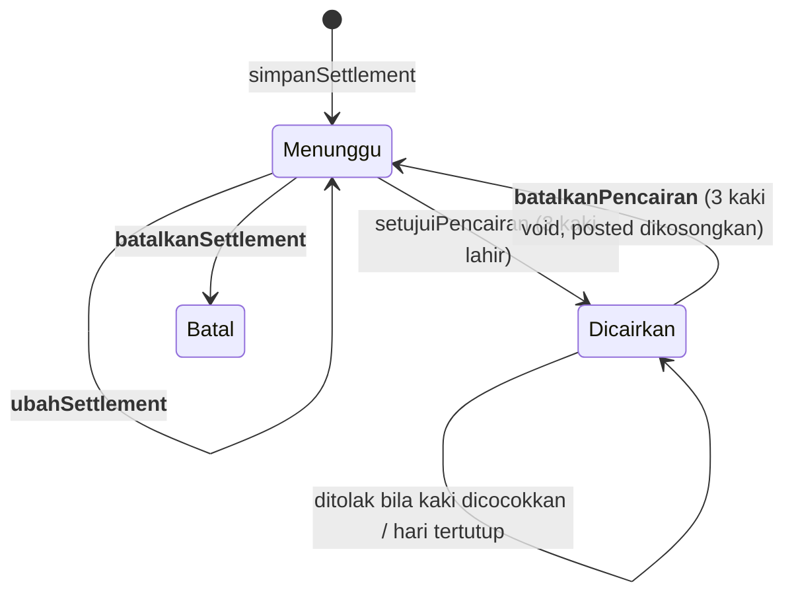

# Settlement EDC — Batalkan, Ubah, dan Wewenang Tim Finance - Plan

## Goal Capsule

- **Objective:** Tim Finance (staf Keuangan dan Head of Finance) bisa membetulkan batch settlement EDC yang salah atau terinput ganda sampai buku bank, EDC Penampungan, dan Beban MDR kembali benar, tanpa mutasi tambalan dan tanpa menunggu orang lain. Siapa membatalkan apa, dan kapan, tetap terbaca.
- **Means:** Dua tindakan baru di server, "Batalkan pencairan" (ketiga kaki sekaligus) dan "Batalkan batch", ditambah penyuntingan batch yang belum dicairkan. Semuanya di belakang satu predikat wewenang baru untuk seluruh siklus settlement (KTD1, KTD2, KTD3).
- **Product authority:** Dion (Direktur / pemilik). `apps/dashboard/KEUANGAN-HARIAN.md` tetap mengikat. Rencana ini mencatat pengecualian baru di sana (U5) dan tidak mencabut aturan lain.
- **Execution profile:** Standard · tanpa migrasi DB · menyentuh uang dan wewenang.
- **Stop conditions:** Berhenti dan tanya Dion bila (a) ternyata perlu migrasi atau menyunting migrasi lama, (b) sebuah jalur akan menulis ke hari yang sudah ditutup, (c) pembersihan data nyata (Bakau 2 Okt) perlu memilih batch mana yang ganda, atau (d) merge ke `main`/gerbang `pilot` diperlukan karena klasifier memblokir agen.
- **Who finishes:** `ce-work` mengeksekusi di worktree `feat/edc-batal-ubah-settlement` (dari `origin/staging`), membuka PR ke `staging`, dan memverifikasi di tier testing `-rlsstg`. Sesudah itu PR `staging → main`. Dion meng-approve gerbang `pilot`. Verifikasi produksi dilakukan di `solamax.solagroup.co`.
- **Open blockers:** Tidak ada untuk eksekusi. Lihat Open Questions untuk kasus Bakau 2 Okt.

---

## Product Contract

### Summary

Blok 3 "Settlement EDC" di Input keuangan mendapat tiga tindakan. **Batalkan pencairan** membatalkan ketiga baris jurnal pencairan (Bank neto, Beban MDR, EDC Penampungan bruto) dalam satu transaksi, lalu batch kembali berstatus "menunggu persetujuan". **Ubah** menyunting batch yang belum dicairkan. **Batalkan batch** mem-void batch yang belum dicairkan. Baris pencairan di buku bank memakai tombol "Batalkan pencairan" yang sama, menggantikan chip "hubungi Head of Finance". Seluruh siklus settlement (input, setujui, batalkan, ubah) terbuka bagi staf Keuangan dan Head of Finance.

### Problem Frame

Bakau 2 Oktober 2026 (rekening BCA 5125978301) memuat dua baris "Pencairan EDC BCA 2026-10-02" masing-masing Rp 1.504.440. Tim Finance tidak bisa membatalkan salah satunya. Mereka menambalnya dengan mutasi manual "pengembalian edc karena dobel" −Rp 1.504.440. Saldo bank tampak benar, tetapi EDC Penampungan dikredit dua kali, Beban MDR tercatat dua kali, dan batch ganda tetap dihitung di kontrol MDR%.

Kondisi kode hari ini (`origin/main` 71126a4):

- Baris kas yang lahir dari pencairan (`cash_ledger.edc_settlement_id IS NOT NULL`) adalah "baris sistem". `voidMutasiKas` menolaknya di server, dan layar menggantinya dengan chip yang menyuruh menghubungi Head of Finance (`keuangan-kas-model.ts`, `PENJELASAN_BARIS_SISTEM.pencairan_edc`).
- **Tidak ada satu pun tindakan yang mem-void `edc_settlement` atau membatalkan jurnal pencairan.** Kolom `void/voided_by/voided_at` sudah ada sejak 0030, dan Pemantauan sudah punya cabang `batal_settlement`, tetapi tak ada jalur tulis yang memakainya. HoF pun tidak punya alat itu.
- Batch yang sudah tersimpan tidak bisa disunting.
- Persetujuan pencairan (`setujuiPencairan`) memakai `canInputKeuangan`: staf `keuangan` dan `super_admin` boleh, **pemegang Head of Finance ditolak** ("HoF menyetujui, bukan mengetik", §10.12). Jadi "menunggu HoF" yang dirasakan tim bukan gerbang persetujuan. Itu jalan pembatalan yang menunjuk HoF tanpa alat.
- Tidak ada peringatan bila batch kedua dengan EDC, tanggal cair, dan bruto yang sama disimpan dengan nomor settlement berbeda. Indeks unik hanya menjaga `(unit, acquirer, settlement_no)`.

### Key Decisions

- **Seluruh tim Finance memegang siklus settlement** — staf Keuangan dan Head of Finance sama-sama boleh input, setujui, batalkan, dan ubah. Ini pengecualian sempit dari §10.12, setara §10.29 (reklasifikasi). Governs R1, R2. (session-settled: user-directed — chosen over "staf saja" dan "staf input, HoF batalkan": Dion ingin settlement selesai di tim Finance tanpa menunggu.)
- **Hari buku yang sudah ditutup → pembatalan ditolak dengan pesan**, bukan dibalik maju. Governs R6. (session-settled: user-approved — chosen over pembalikan maju: pola `batalkanPenebusan`, cakupan lebih kecil.)
- **Akun tim Finance = akun staf ber-peran `keuangan`.** Masalahnya ada pada fitur yang tidak ada, bukan pada konfigurasi akun. `HEAD_OF_FINANCE_EMAILS` tidak diubah. (session-settled: user-directed — chosen over memindahkan `finance.solagroup@gmail.com` dari daftar HoF.)

### Requirements

**Wewenang**

- R1. Staf Keuangan, Head of Finance, dan super admin boleh menyimpan batch, menyetujui pencairan, membatalkan pencairan, mengubah batch, dan membatalkan batch. Peran lain (pengawas, direksi, admin perusahaan) ditolak di server dengan pesan yang sama seperti di layar.
- R2. Pengecualian HoF hanya berlaku untuk siklus settlement EDC. Seluruh input harian lain tetap mengikuti `canInputKeuangan` (§10.12).

**Membatalkan pencairan**

- R3. "Batalkan pencairan" mem-void ketiga kaki jurnal sebuah batch dalam satu transaksi: dua baris `cash_ledger` dan baris `noncash_expense` MDR bila ada. Batch kembali berstatus "menunggu persetujuan" dan bisa disetujui ulang. Tidak ada baris yang dihapus.
- R4. Tombol "Batalkan pencairan" tersedia di blok 3 (baris batch yang sudah dicairkan) dan di buku kas/bank pada setiap baris yang lahir dari pencairan. Konfirmasinya dua klik di tempat, sama dengan "Batalkan" mutasi biasa.
- R5. Bila salah satu kaki pencairan berada di kelompok cocok rekening koran yang aktif, pembatalan ditolak dengan pesan bahwa cocoknya harus dibatalkan lebih dulu (wewenang HoF, R31 rencana 2026-10-29, tidak berubah).
- R6. Bila hari buku kaki pencairan (tanggal settlement) sudah ditutup, pembatalan ditolak dengan pesan yang menyebut tanggalnya dan bahwa koreksi hari tertutup belum tersedia. Persetujuan (ulang) pencairan ke tanggal settlement yang sudah ditutup juga ditolak dengan pesan yang sama. Tanpa penjagaan ini, batal → ubah tanggal → setujui ulang akan menulis jurnal ke buku yang sudah ditutup.

**Mengubah dan membatalkan batch**

- R7. Batch yang belum dicairkan bisa diubah: EDC, nomor settlement, tanggal settlement, tanggal penjualan, rekening tujuan, bruto, neto, total transaksi, dan kode alasan. Validasinya sama persis dengan saat menyimpan batch baru.
- R8. Batch yang sudah dicairkan tidak bisa diubah langsung. Layar menyuruh membatalkan pencairannya dulu.
- R9. Batch yang belum dicairkan bisa dibatalkan (void). Batch yang sudah dicairkan harus dibatalkan pencairannya dulu.

**Jejak dan pencegahan**

- R10. Setiap pembatalan pencairan, perubahan, dan pembatalan batch menulis `app.audit_log` dengan pelaku, waktu, dan nilai sebelum/sesudah. Pembatalan pencairan juga merekam persetujuan lama (siapa, kapan) yang tertimpa saat batch disetujui ulang.
- R11. Pemantauan pemakaian menampilkan setiap pembatalan pencairan sebagai satu kejadian bertingkat kuning ("pencairan EDC dibatalkan"), juga sesudah batch-nya disetujui ulang. Kaki pencairan yang void sendirian, tanpa kaki pasangannya batal bersamaan, tetap tampil merah seperti hari ini.
- R12. Saat menyimpan atau mengubah batch, bila batch aktif lain di unit yang sama punya EDC, tanggal settlement, dan bruto yang sama, layar menampilkan peringatan "kemungkinan batch ganda" lengkap dengan nomor settlement batch itu. Simpan tetap diizinkan.

### Acceptance Examples

- AE1. Covers R3, R4. **Diberikan** batch BCA 2 Okt bruto 1.504.440 sudah dicairkan dan harinya terbuka. **Saat** staf Keuangan menekan "Batalkan pencairan" di baris bank lalu "Ya, batalkan". **Maka** tiga baris (Bank +neto, EDC Penampungan −bruto, Beban MDR) bertanda batal, saldo bank turun sebesar neto, batch tampil "menunggu persetujuan", dan usulan jurnalnya muncul lagi.
- AE2. Covers R1. **Diberikan** akun yang terdaftar di `HEAD_OF_FINANCE_EMAILS`. **Saat** ia menyetujui, membatalkan, atau mengubah batch. **Maka** tindakan berhasil. **Saat** ia menyimpan mutasi kas biasa, tindakan tetap ditolak dengan pesan "HoF tidak mengetik".
- AE3. Covers R5. **Diberikan** kaki bank sebuah pencairan sudah dicocokkan dengan rekening koran. **Saat** staf menekan "Batalkan pencairan". **Maka** tidak ada baris yang berubah, dan pesan menyuruh HoF membatalkan cocoknya di Impor rekening koran.
- AE4. Covers R6. **Diberikan** hari 2 Okt sudah ditutup. **Saat** pembatalan diminta. **Maka** tidak ada baris yang berubah, dan pesan menyebut tanggal 2026-10-02 tertutup.
- AE5. Covers R7, R12. **Diberikan** batch belum dicairkan. **Saat** staf mengubah brutonya menjadi sama dengan batch lain ber-EDC dan tanggal sama. **Maka** peringatan batch ganda tampil, simpan berhasil, MDR baru = bruto − neto baru.

### Success Criteria

- Kasus Bakau 2 Okt bisa dibereskan tanpa mutasi tambalan: batch ganda di-void, mutasi "pengembalian edc karena dobel" dibatalkan Finance, dan saldo bank, EDC Penampungan, serta Beban MDR hari itu sama dengan yang seharusnya dari satu batch. Ini hanya berlaku bila hari tersebut masih terbuka (Open Questions).
- Tak ada lagi teks "hubungi Head of Finance" untuk baris pencairan EDC.

### Scope Boundaries

- Pembalikan maju untuk pencairan yang harinya sudah ditutup (KD "Hari tertutup").
- Membatalkan persetujuan "Penjualan EDC per shift → EDC Penampungan" (blok per shift, §10.25).
- Pembatalan cocok rekening koran tetap milik HoF (R31).
- Menolak simpan batch ganda. Ia hanya diperingatkan (R12), karena dua batch sah pada hari yang sama dengan bruto kebetulan sama memang mungkin.
### Deferred to Follow-Up Work

- Pembalikan maju pencairan EDC untuk hari tertutup, bila kasus nyata muncul.

### Open Questions

- (Deferred, tidak memblokir) Apakah hari Bakau 2026-10-02 sudah ditutup? Bila ya, R6 menolak pembatalan batch ganda itu. Dion lalu memutuskan apakah tambalan "pengembalian edc karena dobel" dibiarkan atau pembalikan maju dibangun. Eksekutor memeriksanya saat verifikasi produksi dan melaporkan, tanpa menulis apa pun.
- (Deferred, butuh Dion) Dari dua batch BCA 2 Okt, mana yang ganda? Batalkan pencairan dan batalkan batch dikerjakan Finance atau Dion, bukan agen.

---

## Planning Contract

### Key Technical Decisions

- KTD1. **Satu predikat baru `canKelolaSettlementEdc`** di `keuangan-wewenang.ts` = `canInputKeuangan(ctx) || isHeadOfFinance(ctx.email)`. Ditulis berdiri sendiri dengan komentar keputusan (pola `canReklasifikasi`, §10.29). Semua tindakan di `edc-actions.ts` memakainya lewat `buka()`. Halaman input meneruskan prop `bolehSettlement` terpisah dari `bolehTulis` ke `EdcPanel` dan `BukuKasPanel`. Menurunkan dari `canInputKeuangan` saja akan terus menolak HoF. Melonggarkan `canInputKeuangan` membuka semua input lain untuk HoF (melanggar R2). (session-settled: user-directed — inherits KD "Seluruh tim Finance memegang siklus settlement", Governs R1, R2.)
- KTD2. **Tanpa migrasi.** "Batalkan pencairan" = `UPDATE … SET void` pada kaki-kakinya, plus `UPDATE edc_settlement SET posted_by_user_id = NULL, posted_at = NULL`. CHECK `edc_settlement_posted_pair` mengizinkan pasangan NULL. `dashboard_app` sudah punya UPDATE di ketiga tabel (0030, 0031). Persetujuan lama yang tertimpa disimpan di `audit_log.detail` (R10). Kolom riwayat baru akan menuntut migrasi tanpa menambah apa pun yang belum ada di audit_log dan kaki-kaki yang void. Akibat yang diterima: laporan aktivitas Pemantauan ("pencairan EDC" dari `posted_by/posted_at`) tidak lagi menampilkan persetujuan pertama. Jejaknya tetap ada di `audit_log.detail` dan di `created_by_user_id/created_at` kaki-kaki yang void.
- KTD3. **Batalkan pencairan meniru `batalkanPenebusan`** (`penebusan-actions.ts`): `requireUnit` → BEGIN → `set_config('app.unit_ids')` → kunci batch dan kakinya `FOR UPDATE` → tolak bila ada kaki di `cocok_bank_baris` aktif (R5) → `hariBukuTerkunci` untuk tanggal settlement pada rekening tujuan **dan** rekening EDC Penampungan, tolak bila `hariBuku !== settlement_date` (R6) → void kaki → kosongkan posted → `auditKeuangan` → COMMIT. Urutan ini membuat penutupan hari yang bersamaan menunggu, bukan tersalip.
- KTD4. **Ubah batch = UPDATE di tempat**, hanya bila `NOT void AND posted_at IS NULL` (dikunci `FOR UPDATE`). Validasi `simpanSettlement` dipindah ke satu fungsi murni (`validasiSettlement` di `keuangan-edc.ts`) yang dipakai simpan **dan** ubah. Dua salinan aturan akan berselisih. Pelanggaran indeks unik `edc_settlement_no_uq` diterjemahkan menjadi pesan "nomor settlement sudah dipakai batch lain".
- KTD5. **Batalkan batch hanya untuk batch belum dicairkan** (R9). Batch yang sudah dicairkan ditolak di server, bukan hanya disembunyikan tombolnya. Membatalkan batch sekaligus pencairannya dalam satu tombol tidak dibangun, sebab dua langkah membuat pelaku melihat jurnalnya kembali menjadi usulan sebelum batch hilang.
- KTD6. **Baris sistem tetap baris sistem.** `voidMutasiKas` tetap menolak baris pencairan. Tombol di buku bank memanggil `batalkanPencairan(settlementId)`, bukan `voidMutasiKas`. Karena itu tidak ada jalan yang mem-void satu kaki saja. Untuk itu `getMutasiKas` (`keuangan-input-queries.ts`) memilih `edc_settlement_id::text AS "edcSettlementId"`. Field itu ditambahkan ke `MutasiKasRow` dan ke tipe masukan `MutasiKas` milik `barisBuku` (`keuangan-kas-model.ts`), lalu terbawa ke `BarisBuku` lewat spread yang sudah ada.
- KTD7. **Pemantauan membedakan pembatalan utuh dari kaki yatim lewat fakta saat pembatalan, bukan keadaan batch sekarang** (R11). Di `KUERI_KEJADIAN` (`keuangan-pantau-queries.ts`), kaki `cash_ledger` void ber-`edc_settlement_id` dianggap bagian dari pembatalan utuh bila ada kaki void lain dengan `edc_settlement_id` dan `voided_at` yang sama (keduanya di-void dalam satu transaksi `batalkanPencairan`). Pasangan seperti itu memancarkan **satu** baris `batal_pencairan_edc` (kuning), diambil dari kaki EDC Penampungan saja (join `cash_account.kind = 'edc_penampungan'`). Kedua kakinya dikeluarkan dari cabang `batal_kaki_edc`. Kaki void tanpa pasangan tetap `batal_kaki_edc` (merah). Cabang `batal_beban_nonkas` juga mengecualikan baris `noncash_expense` void yang `edc_settlement_id`-nya punya kaki kas void dengan `voided_at` sama, supaya satu pembatalan tidak tampil dua kali. Sumbernya hanya tabel ber-RLS. `audit_log` (tanpa `unit_id`, tanpa RLS) **tidak** dipakai sebagai sumber Pemantauan, sejalan dengan komentar cabang U6/U9 di berkas yang sama.
- KTD8. **Peringatan batch ganda dihitung di layar** dari `settlements` yang sudah dimuat (jendela 60 hari, `getSettlements`) lewat fungsi murni `calonGanda` di `keuangan-edc.ts`. Tidak ada kueri baru dan server tidak menolak.

### High-Level Technical Design

Status batch dan transisinya (yang baru dicetak tebal):

### Implementation Constraints

- Ikuti aturan repo di `CLAUDE.md`: PR ke `staging` dulu, tidak ada push ke `main` tanpa instruksi, rahasia tidak masuk git.
- Setiap kueri tulis di dalam transaksi yang memasang `app.unit_ids` (RLS fail-closed). Unit diambil dari `scope.requireUnit(code)`, tak pernah dari input client.
- Nominal selalu dibaca ulang dari DB di server. Dari client hanya datang id batch dan isian formulir (pola `setujuiPencairan`).

---

## Implementation Units

### U1. Predikat wewenang settlement

- **Goal:** Satu gerbang yang meloloskan staf Keuangan, HoF, dan super admin untuk seluruh siklus settlement.
- **Requirements:** R1, R2 (KTD1).
- **Dependencies:** —
- **Files:** `apps/dashboard/src/lib/keuangan-wewenang.ts`, `apps/dashboard/src/lib/keuangan-wewenang.test.ts`
- **Approach:** Tambahkan `canKelolaSettlementEdc` dan pesan penolakannya. Komentarnya menjelaskan pengecualian §10.12 dan merujuk keputusan 2 Nov 2026. `canInputKeuangan` tidak disentuh.
- **Patterns to follow:** `canReklasifikasi`, `canAturRekeningEdc`.
- **Test scenarios:**
  - `keuangan` bukan HoF → true.
  - `keuangan` yang juga HoF → true (berbeda dari `canInputKeuangan`, yang false).
  - Email HoF berperan `admin_perusahaan` → true.
  - `super_admin` → true.
  - `pengawas`, `direksi`, `admin_perusahaan` bukan HoF → false.
  - Daftar HoF kosong dan peran `direksi` → false (fail-closed).
  - Penjaga regresi: `canInputKeuangan` untuk HoF tetap false.
- **Verification:** Uji wewenang hijau. Tidak ada pemanggil lama yang berubah perilaku.

### U2. Validasi bersama dan tindakan server batch (ubah, batalkan batch, gerbang baru)

- **Goal:** Batch yang belum dicairkan bisa diubah dan dibatalkan. Semua tindakan settlement memakai gerbang U1.
- **Requirements:** R1, R7, R8, R9, R10 (KTD4, KTD5).
- **Dependencies:** U1
- **Files:** `apps/dashboard/src/lib/keuangan-edc.ts`, `apps/dashboard/src/lib/keuangan-edc.test.ts`, `apps/dashboard/src/lib/edc-actions.ts`, `apps/dashboard/src/lib/edc-actions.guard.test.ts`
- **Approach:**
  1. Pindahkan aturan input `simpanSettlement` (tanggal, urutan H/H+1, acquirer/nomor wajib, bruto > 0, 0 < neto ≤ bruto, kode alasan wajib bila ada selisih) ke `validasiSettlement` yang murni. `simpanSettlement` memanggilnya.
  2. `buka()` memakai `canKelolaSettlementEdc`.
  3. `ubahSettlement(input + id)`: kunci baris `NOT void AND posted_at IS NULL FOR UPDATE`. Tolak dengan pesan R8 bila sudah dicairkan, tolak bila batch sudah void. UPDATE kolom yang boleh (normalisasi acquirer lewat `normalisasiEdc`). `auditKeuangan('edc_settlement.ubah', …, {sebelum, sesudah})`.
  4. `batalkanSettlement(id)`: kunci baris, tolak bila sudah dicairkan (R9), lalu `SET void, voided_by, voided_at` + audit `edc_settlement.batal`.
  5. Terjemahkan galat unik `edc_settlement_no_uq` menjadi pesan yang ramah, baik di simpan maupun ubah.
- **Patterns to follow:** `simpanSettlement` / `setujuiPencairan` (struktur transaksi), `batalkanPenebusan` (audit, pesan "muat ulang").
- **Test scenarios:**
  - `validasiSettlement`: neto > bruto ditolak, bruto 0 ditolak, tanggal settlement < tanggal jual ditolak, selisih tanpa kode alasan ditolak, input sah lolos (unit murni).
  - Penjaga teks: `ubahSettlement` dan `batalkanSettlement` memuat `posted_at IS NULL` dan `FOR UPDATE` di WHERE, memanggil `set_config('app.unit_ids'`, memanggil `auditKeuangan`, dan tidak menulis `mdr_rp` (GENERATED).
  - Penjaga teks: `buka` memanggil `canKelolaSettlementEdc`, bukan `alasanTakBolehInput`.
  - Penjaga teks: `simpanSettlement` dan `ubahSettlement` sama-sama memanggil `validasiSettlement`.
- **Verification:** Uji hijau. Typecheck lulus.

### U3. Tindakan server "Batalkan pencairan"

- **Goal:** Membalik jurnal pencairan secara utuh, aman terhadap cocok bank dan hari tertutup.
- **Requirements:** R3, R5, R6, R10 (KTD2, KTD3).
- **Dependencies:** U1, U2 (berbagi `buka`)
- **Files:** `apps/dashboard/src/lib/edc-actions.ts`, `apps/dashboard/src/lib/edc-actions.guard.test.ts`, `apps/dashboard/src/lib/edc-settlement.integration.test.ts` (baru)
- **Approach:** Ikuti urutan KTD3:
  1. Kunci batch `NOT void AND posted_at IS NOT NULL FOR UPDATE`, dan kaki `cash_ledger` aktifnya `FOR UPDATE`.
  2. Cek cocok bank aktif untuk kaki mana pun (R5).
  3. `hariBukuTerkunci` untuk `settlement_date` di rekening tujuan dan rekening Penampungan (R6).
  4. Void kedua kaki `cash_ledger` dan `noncash_expense` milik batch.
  5. Kosongkan `posted_by_user_id/posted_at`.
  6. Audit `edc_settlement.batal_pencairan` dengan `{postedByLama, postedAtLama, kaki: [...], netRp, grossRp, mdrRp}`.
  7. Revalidate halaman input pada tanggal halaman **dan** tanggal settlement.
  8. `setujuiPencairan` mendapat penjaga hari tertutup yang sama (R6): `hariBukuTerkunci` untuk `settlement_date` di rekening tujuan dan rekening Penampungan sesudah batch dikunci, dan ditolak bila `hariBuku !== settlement_date`.
- **Execution note:** Tulis uji integrasi DB lebih dulu (pola `penebusan.integration.test.ts`, gated env, hanya di `solamax-pg-rlsstg`, setiap kasus di-ROLLBACK). Yang dibuktikan: CHECK `posted_pair` menerima pengosongan dan RLS menolak lintas unit.
- **Test scenarios:**
  - Covers AE1. Integrasi: batch tercairkan → batalkan → tiga kaki `void=true` dengan `voided_by` terisi, batch `posted_at IS NULL`, lalu `setujuiPencairan` lagi melahirkan tiga kaki baru (`edc_settlement_id` sama, total kaki aktif tetap 3).
  - Integrasi: batch dengan MDR 0 (tanpa baris `noncash_expense`) → batalkan berhasil, hanya dua kaki yang di-void.
  - Covers AE3. Integrasi: kaki bank ada di `cocok_bank_baris` aktif → ditolak, tak ada baris berubah.
  - Covers AE4. Integrasi: `day_close` tanggal settlement berstatus `closed` → ditolak, tak ada baris berubah.
  - Integrasi: batalkan pencairan → tutup hari tanggal settlement → `setujuiPencairan` ditolak, tak ada kaki baru.
  - Batch yang belum dicairkan atau sudah void → pesan "sudah dibatalkan atau tak ditemukan".
  - Penjaga teks: urutan cek cocok → hari buku → UPDATE kaki → UPDATE batch (pakai `urutan` dari `penjaga-urutan`). Pembatalan memanggil `auditKeuangan`. Tidak ada `DELETE`.
- **Verification:** Uji penjaga hijau di CI. Uji integrasi dijalankan sekali terhadap `solamax-pg-rlsstg` dan hijau, dengan hasilnya ditempel di PR `staging → main`.

### U4. Layar: blok 3 dan buku kas/bank

- **Goal:** Finance melihat dan memakai ketiga tindakan di tempat yang mereka kerjakan.
- **Requirements:** R4, R7, R8, R9, R12 (KTD1, KTD6, KTD8).
- **Dependencies:** U2, U3
- **Files:** `apps/dashboard/src/components/keuangan/EdcPanel.tsx`, `apps/dashboard/src/components/keuangan/BukuKasPanel.tsx`, `apps/dashboard/src/lib/keuangan-kas-model.ts`, `apps/dashboard/src/lib/keuangan-kas-model.test.ts`, `apps/dashboard/src/lib/keuangan-input-queries.ts`, `apps/dashboard/src/lib/keuangan-edc.ts`, `apps/dashboard/src/lib/keuangan-edc.test.ts`, `apps/dashboard/src/app/(app)/keuangan/unit/[code]/[date]/input/page.tsx`
- **Approach:**
  1. Halaman input menghitung `bolehSettlement = canKelolaSettlementEdc(...)` dan meneruskannya ke `EdcPanel` (ganti `bolehTulis`) dan `BukuKasPanel` (prop tambahan).
  2. `EdcPanel`: tiap batch berstatus "sudah dicairkan" mendapat "Batalkan pencairan". Tiap batch "menunggu persetujuan" mendapat "Ubah" dan "Batalkan batch". Konfirmasi dua klik di tempat (pola `yakin` di BukuKasPanel). Tombol konfirmasi pembatalan pencairan berbunyi "Ya, batalkan 3 baris". Pesan suksesnya, di EdcPanel dan BukuKasPanel: "Pencairan dibatalkan — tiga barisnya tercatat batal, tidak dihapus. Batch kembali menunggu persetujuan di blok 3."
  3. "Ubah" membuka formulir yang sama dengan "Tambah batch" dalam mode ubah:
     - Semua isian terisi dari batch, dan `akunDipilihTangan = true` supaya rekening tujuan tersimpan tak pernah ditimpa saran Pengaturan EDC (§10.28).
     - Judulnya "Ubah batch <acquirer> · <nomor>", dan tombol simpannya "Simpan perubahan".
     - "Tambah batch settlement…" disembunyikan selama mengubah.
     - Batal dan simpan yang berhasil sama-sama mengosongkan isian dan kembali ke mode tambah.
     - Menekan "Ubah" pada batch lain mengganti isi formulir.
  4. `calonGanda(settlements, isian, abaikanId)` di `keuangan-edc.ts`. Formulir simpan/ubah menampilkan peringatan R12 bila hasilnya tidak kosong.
  5. `edcSettlementId` mengalir dari `getMutasiKas` ke `BarisBuku` (KTD6).
  6. `BukuKasPanel`: satu flag `kolomTindakan = bolehTulis || bolehSettlement` menggantikan `bolehTulis` untuk header Tindakan, kelas `ro`, dan sel kosong di baris saldo awal, baris mutasi, dan baris total. Isi sel per baris:
     - Baris `pencairan_edc`: "Batalkan pencairan" (memanggil `batalkanPencairan` dengan `edcSettlementId`) bila `bolehSettlement`.
     - Baris sistem lain: tetap chip.
     - Baris biasa: "Batalkan" hanya bila `bolehTulis`, selain itu sel kosong. HoF tidak pernah melihat "Batalkan" mutasi biasa (R2).
  7. `PENJELASAN_BARIS_SISTEM.pencairan_edc` diganti: "Bagian dari jurnal pencairan EDC — batalkan ketiga barisnya sekaligus dengan 'Batalkan pencairan'."
- **Patterns to follow:** konfirmasi `yakin` dan pesan sukses "tercatat, tidak dihapus" di `BukuKasPanel`. Kelas tombol `btn-outline sm`. Satu pembaca angka `bacaRupiah`.
- **Test scenarios:**
  - `calonGanda`: batch lain sama EDC, tanggal, bruto → ditemukan. Beda bruto 1 rupiah → tidak. Batch void → diabaikan. Batch yang sedang diubah sendiri → diabaikan.
  - `PENJELASAN_BARIS_SISTEM.pencairan_edc` tidak lagi memuat "Head of Finance" (uji model).
  - `barisSistemDari` tetap memulangkan `pencairan_edc` untuk baris pencairan (regresi KTD6).
  - Mode ubah: mengganti tanggal settlement tidak mengganti rekening tujuan yang terisi dari batch (logika saran dipisah jadi fungsi murni bila perlu supaya bisa diuji).
- **Verification:** Di `-rlsstg` (login staf Keuangan uji): alur AE1 dan AE5 berjalan dari layar. Bila akun HoF uji tersedia: baris mutasi biasa tanpa tombol "Batalkan", baris pencairan dengan "Batalkan pencairan". Layar HP (lebar 375) tidak meluap.

### U5. Pemantauan dan dokumentasi keputusan

- **Goal:** Pembatalan yang sah terbaca sebagai kejadian kuning, dan keputusan wewenang tertulis di repo.
- **Requirements:** R11, R2 (KTD7).
- **Dependencies:** U3
- **Files:** `apps/dashboard/src/lib/keuangan-pantau-queries.ts`, `apps/dashboard/src/lib/keuangan-pantau-model.ts`, `apps/dashboard/src/lib/keuangan-pantau-model.test.ts`, `apps/dashboard/KEUANGAN-HARIAN.md`
- **Approach:** Tambahkan jenis `batal_pencairan_edc` (label "Pencairan EDC dibatalkan", tingkat kuning) dan rute SQL-nya per KTD7. Tambahkan §10.x baru di `KEUANGAN-HARIAN.md`: keputusan owner 2 Nov 2026 (siklus settlement milik tim Finance termasuk HoF, pembatalan pencairan, hari tertutup ditolak), dengan rujukan ke §10.12 dan §10.29.
- **Test scenarios:**
  - Model: `batal_pencairan_edc` → "kuning" dan berlabel. `batal_kaki_edc` tetap "merah".
  - SQL lulus `check-sql-syntax` (bagian dari `pnpm check`).
  - Integrasi (di berkas uji U3): batalkan pencairan ber-MDR → `KUERI_KEJADIAN` memulangkan tepat satu `batal_pencairan_edc` dan nol `batal_kaki_edc`/`batal_beban_nonkas` untuk batch itu. Sesudah disetujui ulang, hasilnya tetap sama.
  - Integrasi: satu kaki pencairan di-void langsung lewat SQL (simulasi kaki yatim) → tetap `batal_kaki_edc` merah.
- **Verification:** Di `-rlsstg`, Pemantauan pemakaian menampilkan satu kejadian kuning sesudah AE1, dan tetap satu kejadian kuning sesudah batch disetujui ulang.

### U6. Rilis dan verifikasi

- **Goal:** Fitur tayang di pilot produksi dan terbukti bekerja tanpa menulis data nyata atas inisiatif agen.
- **Requirements:** semua, plus Success Criteria.
- **Dependencies:** U1–U5
- **Files:** —
- **Approach:**
  1. PR `feat/edc-batal-ubah-settlement` → `staging`. CI hijau, lalu merge. Deploy otomatis ke `-rlsstg`.
  2. Uji integrasi U3 terhadap `solamax-pg-rlsstg`. Uji layar AE1–AE5 di `-rlsstg` lewat host `AUTH_URL`.
  3. PR `staging → main`. Dion merge dan approve gerbang `pilot` (agen bisa diblokir klasifier, lihat Stop conditions).
  4. Verifikasi produksi: revisi `solamax-dashboard-staging` yang melayani 100% trafik adalah digest build commit ini (verifikasi di tingkat revisi, bukan `spec.template`). Halaman Input keuangan Bakau 2026-10-02 menampilkan tombol "Batalkan pencairan" pada baris pencairan, dan blok 3 menampilkan "Ubah"/"Batalkan batch" pada batch yang menunggu. **Tidak ada tombol yang ditekan di produksi oleh agen.**
  5. Laporkan status hari Bakau 2 Okt (tertutup atau terbuka) dan dua batch BCA-nya (nomor, pembuat, penyetuju) supaya Dion atau Finance memilih batch yang dibatalkan.
- **Test expectation:** none -- unit rilis. Bukti ada di U1–U5 dan verifikasi tier.
- **Verification:** Revisi produksi cocok dengan digest build. Tangkapan layar produksi menunjukkan tombol baru. Laporan Bakau 2 Okt dikirim ke Dion.

---

## Verification Contract

| Gerbang | Perintah / tempat | Kapan |
|---|---|---|
| Typecheck + uji unit + cek SQL | `pnpm check` di root repo (butuh `cd apps/backend && pnpm exec prisma generate` di worktree segar) | setiap unit, sebelum PR |
| Uji integrasi DB U3 | `pnpm --filter @solamax/dashboard exec vitest run src/lib/edc-settlement.integration.test.ts` dengan env gated yang menunjuk **hanya** `solamax-pg-rlsstg` | sekali sebelum PR staging→main |
| CI repo | GitHub Actions `ci.yml` pada PR | PR ke `staging` dan ke `main` |
| Uji layar tier testing | `https://solamax-dashboard-rlsstg-113869564052.asia-southeast2.run.app` (host `AUTH_URL`) — AE1–AE5 | sesudah merge staging |
| Produksi | `solamax.solagroup.co` — revisi = digest build, tombol tampil, baca-saja | sesudah gerbang `pilot` |

## Definition of Done

- U1–U5 tergabung di `staging` dan `main`. `pnpm check` dan CI hijau.
- Uji integrasi U3 hijau di DB testing, dengan keluaran ditempel di PR `staging → main`.
- AE1–AE5 terbukti di `-rlsstg`.
- Revisi produksi dashboard melayani 100% trafik dengan digest build commit rilis.
- `KEUANGAN-HARIAN.md` memuat keputusan wewenang 2 Nov 2026.
- Tidak ada kode percobaan yang ditinggal. Tidak ada `DELETE` baru di jalur keuangan.
- Laporan Bakau 2 Okt (status hari, dua batch) diserahkan ke Dion. Pembersihan data nyata tetap keputusan Dion/Finance.
